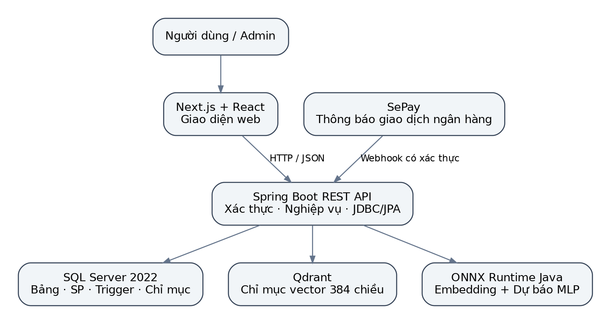
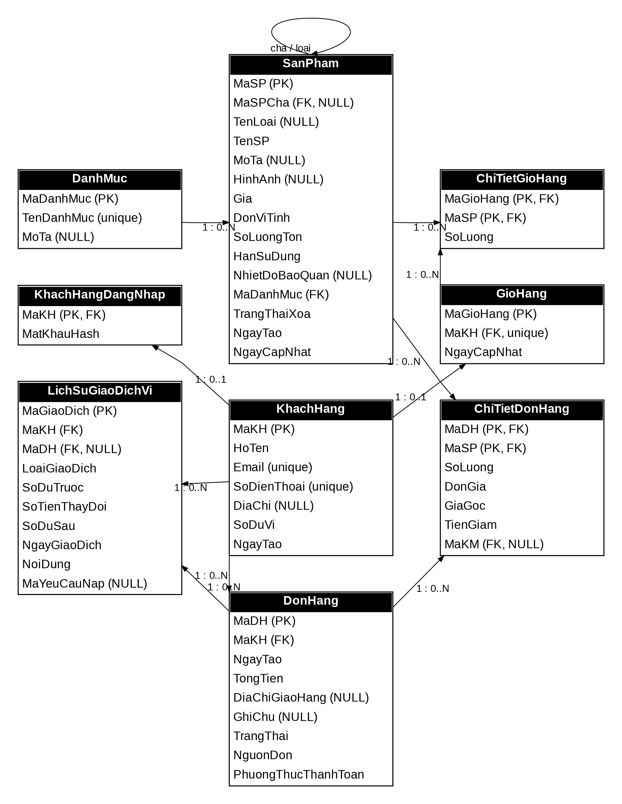
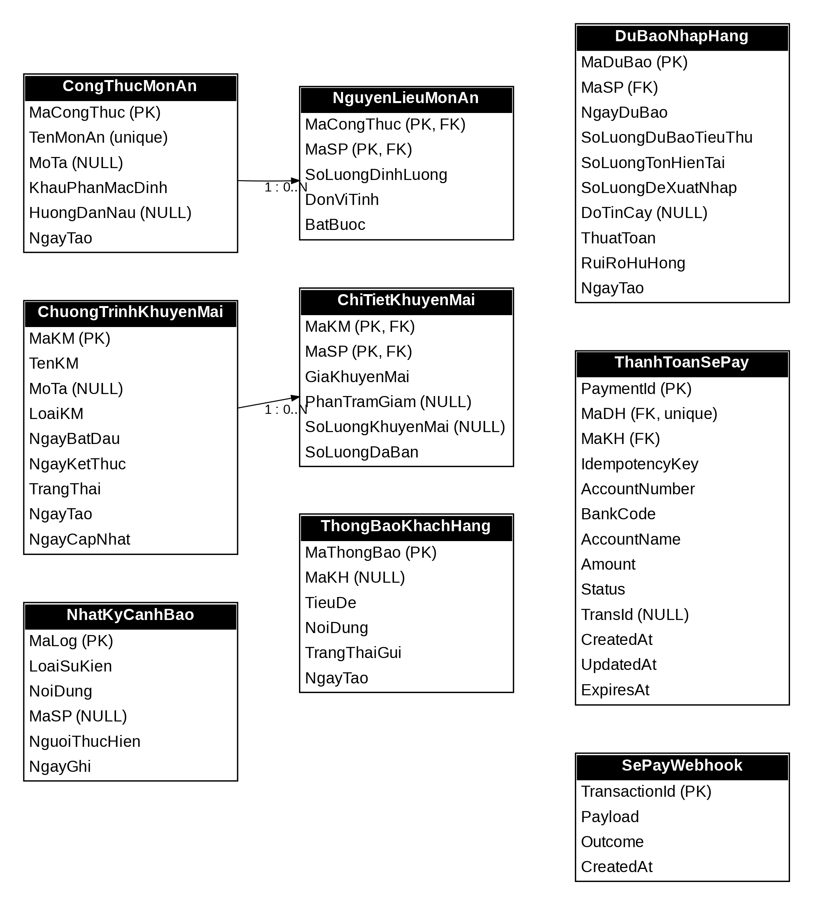
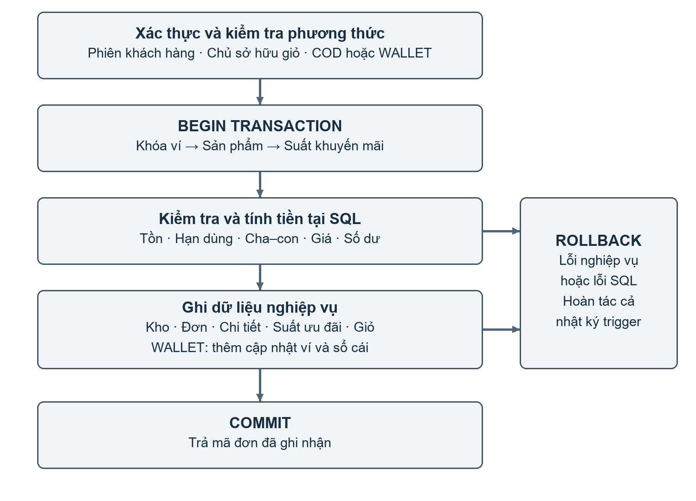
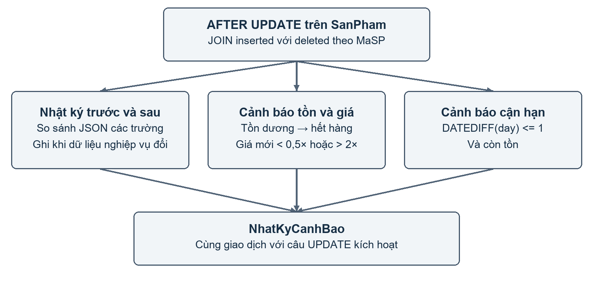
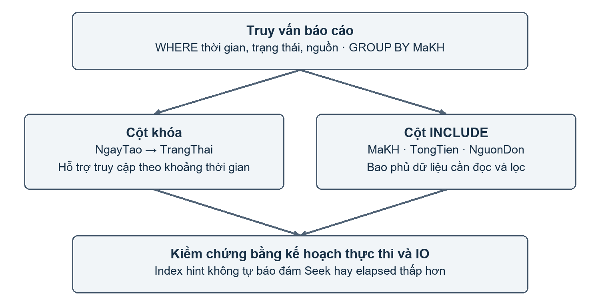
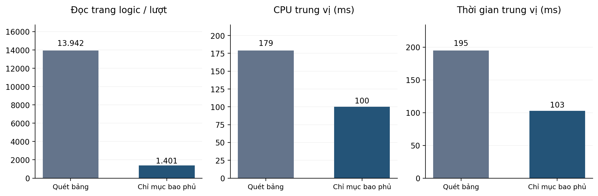
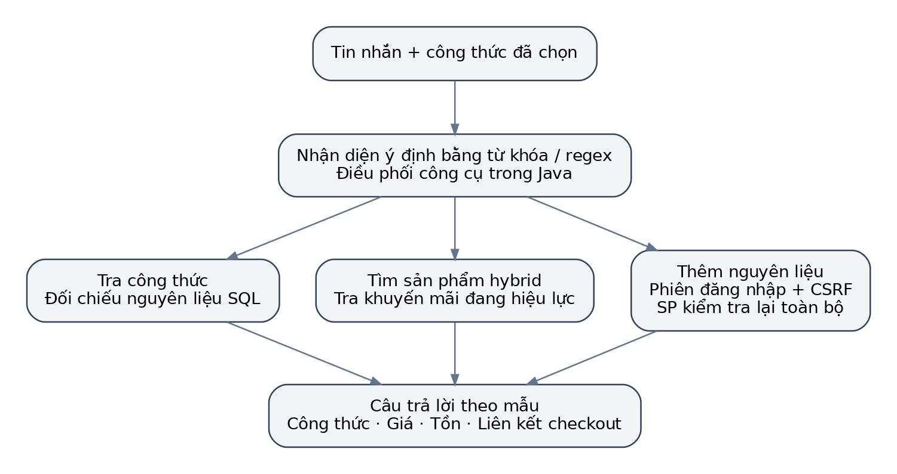
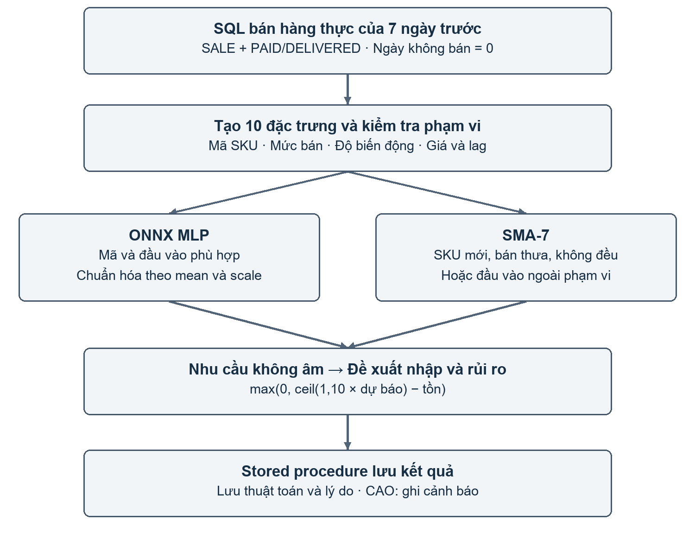

# TÓM TẮT

DailyMart là hệ thống quản lý và bán thực phẩm tươi sống phục vụ đồ án CT221H. Vấn đề cốt lõi là giữ nhất quán dữ liệu sản phẩm, tồn kho, khuyến mãi, đơn hàng và số dư ví khi nhiều thao tác cùng truy cập. SQL Server là nguồn dữ liệu nghiệp vụ; thủ tục lưu đóng gói các thao tác chính; transaction điều phối commit và rollback; trigger kiểm soát, ghi nhận thay đổi; index giảm chi phí truy vấn báo cáo. Giao diện Next.js và backend Spring Boot cung cấp luồng mua hàng và quản trị trên nền các cơ chế đó.

Báo cáo trình bày thiết kế quan hệ, hiện thực T-SQL và tích hợp Java theo mã nguồn trên nhánh dev_Can, commit 8596219, ngày 15/11/2026. Trong phép đo có kiểm soát đã lưu trên 500.000 đơn hàng, chỉ mục bao phủ giảm logical reads từ 13.942 xuống 1.401, tương ứng 89,95%, và giảm thời gian trung vị từ 195 xuống 103 ms. Kiểm tra rollback ngày 15/11 cho thấy giá, tồn kho và nhật ký cùng được hoàn tác khi một câu lệnh vi phạm CHECK. Đây là bằng chứng trong phạm vi thử nghiệm, chưa phải đánh giá tải vận hành dài hạn.

Hai phân hệ hỗ trợ quyết định được đặt sau phần cơ sở dữ liệu: hybrid search kết hợp BM25 với vector MiniLM qua RRF; chatbot gọi công cụ lấy công thức, kiểm kho và thêm nguyên liệu. Dự báo sử dụng ONNX khi đầu vào thuộc phạm vi áp dụng và trung bình bán bảy ngày khi sản phẩm mới, bán thưa hoặc đầu vào bất thường. Các chỉ số mô hình hiện có được đo trên dữ liệu mô phỏng, không được diễn giải thành độ tin cậy cho từng sản phẩm thực tế.

Từ khóa: SQL Server; stored procedure; transaction; trigger; index; hybrid search; ONNX; DailyMart.

# Chương 1. Tổng quan bài toán và Kiến trúc hệ thống

## 1.1. Bài toán quản lý thực phẩm tươi sống

Thực phẩm tươi sống có thời gian sử dụng ngắn, tồn kho thay đổi nhanh và thường được bán theo nhiều quy cách. Một mặt hàng có thể có loại 300 g, 500 g và 1 kg với giá, tồn và hạn dùng riêng. Khuyến mãi còn phụ thuộc thời gian hiệu lực và số suất còn lại. Vì vậy, việc hiển thị giá và tồn trên trình duyệt chỉ cung cấp thông tin tại thời điểm đọc; điều kiện mua phải được kiểm tra lại ngay trong giao dịch ghi dữ liệu.

Tình huống tiêu biểu là hai khách hàng cùng mua phần tồn cuối. Nếu hệ thống đọc tồn, kiểm tra rồi cập nhật bằng các thao tác rời rạc, cả hai yêu cầu có thể cùng được chấp nhận. Tương tự, thanh toán ví có thể trừ tiền nhưng chưa tạo đủ chi tiết đơn nếu gặp lỗi giữa chừng. DailyMart tổ chức các bước liên quan trong cùng transaction và đặt kiểm tra nghiệp vụ tại cơ sở dữ liệu để giảm các trạng thái dở dang [1], [2], [3].

Ngoài bán hàng, quản trị viên cần biết hàng sắp hết, hàng cận hạn, giá thay đổi bất thường và lịch sử thao tác. Hệ thống lưu nhật ký và sổ cái ví để phục vụ đối chiếu. Dự báo và chatbot khai thác dữ liệu này nhưng không thay thế quy tắc kiểm kho, tính tiền hoặc quyền xác nhận thanh toán.

## 1.2. Mục tiêu và phạm vi

Mục tiêu chính là hiện thực một ứng dụng có nghiệp vụ đủ để minh họa các cơ chế của hệ quản trị cơ sở dữ liệu. Trọng tâm gồm thiết kế khóa và ràng buộc, thủ tục lưu có tham số đầu vào và đầu ra, transaction có xử lý lỗi, trigger hoạt động theo tập bản ghi và index được đánh giá bằng kế hoạch thực thi cùng số lần đọc trang.

Phạm vi chức năng bao gồm quản lý danh mục và sản phẩm; loại sản phẩm; giỏ hàng; thanh toán COD và ví; chương trình khuyến mãi; theo dõi đơn; phân nhóm khách hàng; nhật ký cảnh báo; tìm kiếm; công thức món ăn và dự báo nhập hàng. Luồng SePay có mã tiếp nhận webhook và đối soát nhưng cấu hình cục bộ hiện chưa khả dụng; đợt kiểm thử này không phát sinh giao dịch ngân hàng thật.

@Table Bảng 1.1. Tác nhân và các nghiệp vụ chính
| Tác nhân | Nghiệp vụ | Điểm kiểm soát dữ liệu |
| --- | --- | --- |
| Khách hàng | Tìm hàng, chọn loại, quản lý giỏ, đặt đơn, xem ví và lịch sử | Phiên đăng nhập, chủ sở hữu, kiểm kho và kiểm giá tại server |
| Quản trị viên | Sản phẩm, khuyến mãi, đơn hàng, nạp ví, cảnh báo và dự báo | Vai trò ADMIN, CSRF, xác nhận thao tác và nhật ký |
| Dịch vụ thanh toán | Gửi thông báo giao dịch qua webhook | Khóa xác thực, mã giao dịch duy nhất, đối chiếu số tiền và trạng thái |

## 1.3. Kiến trúc tổng thể

Hệ thống được triển khai thành các thành phần giao diện, API, cơ sở dữ liệu quan hệ, cơ sở dữ liệu vector và bộ suy luận. Trình duyệt gọi API qua HTTP/JSON; API truy cập SQL Server thông qua Spring JDBC, SimpleJdbcCall hoặc JPA tùy nghiệp vụ. Qdrant lưu chỉ mục tìm kiếm; ONNX Runtime chạy embedding và mô hình dự báo trong tiến trình Java.



SQL Server giữ dữ liệu có giá trị nghiệp vụ như đơn hàng, số dư, giá giao dịch và tồn kho. Vector có thể được đồng bộ lại từ danh mục SQL. Khi chỉ mục vector lỗi hoặc trễ cập nhật, kết quả tìm kiếm phải được đối chiếu lại với danh mục hiện hành; một điểm cosine cao không cho phép bỏ qua tình trạng ngừng kinh doanh, hết hạn hoặc không đủ tồn.

Controller tiếp nhận request và kiểm tra định dạng, phiên và quyền. Service phối hợp các bước nghiệp vụ. Repository chịu trách nhiệm truy cập dữ liệu và ánh xạ kết quả. Thủ tục SQL tiếp tục kiểm tra điều kiện ở thời điểm ghi dữ liệu. Cách phân chia này giúp giữ giao diện độc lập với SQL, nhưng yêu cầu kiểm tra cả Java và T-SQL khi thay đổi một quy tắc liên quan nhiều phân hệ.

## 1.4. Công nghệ và triển khai

@Table Bảng 1.2. Thành phần công nghệ trong repository
| Thành phần | Công nghệ | Vai trò |
| --- | --- | --- |
| Giao diện | Next.js 16.4.2, React 19.3.0, TypeScript | Cửa hàng, checkout, ví và quản trị |
| Backend | Java 21, Spring Boot 3.3.4, Spring Security | REST API, phiên, quyền và nghiệp vụ |
| CSDL quan hệ | SQL Server 2022 Developer | Bảng, SP, transaction, trigger và index |
| Truy cập dữ liệu | JDBC, SimpleJdbcCall, JPA | Gọi thủ tục và thực thi truy vấn có tham số |
| Tìm kiếm và AI | Qdrant, ONNX Runtime Java 1.18.0 | Vector cosine, MiniLM và MLP |
| Kiểm thử | JUnit, Mockito, Spring Test, Node test, Chrome tự động | Kiểm tra SQL, API, giao diện và hồi quy |

Docker Compose cung cấp SQL Server, backend và Qdrant; giao diện có thể chạy riêng tại cổng 3000. Backend dùng cổng 8085; SQL Server được ánh xạ ra loopback 1434 trong môi trường phát triển. Cấu hình mẫu chỉ phù hợp trình diễn; triển khai thật cần quản lý bí mật, giới hạn tài khoản SQL, HTTPS, sao lưu và quan sát lỗi. Báo cáo không đưa mật khẩu hoặc khóa webhook vào tài liệu.

## 1.5. Các luồng nghiệp vụ xuyên suốt

Luồng bán hàng đi từ tìm kiếm và chọn loại đến thêm giỏ, kiểm tra checkout và gọi thủ tục thanh toán. Sau commit, khách hàng xem đơn; quản trị viên có thể giao hoặc hủy theo trạng thái hợp lệ. Hủy đơn ví hoàn tiền và kho; hủy COD hoàn kho nhưng không ghi hoàn tiền ví. Trạng thái trên giao diện phải được đọc từ dữ liệu đã ghi nhận.

Luồng công thức bắt đầu bằng truy vấn món ăn. Chatbot lấy công thức và kiểm tra khả năng cung ứng. Khi khách xác nhận thêm nguyên liệu, một thủ tục kiểm tra lại toàn bộ nguyên liệu trong giao dịch trước khi sửa giỏ. Checkout vẫn là bước riêng; việc thêm giỏ không đồng nghĩa giữ hàng hoặc thanh toán.

Luồng quản trị gồm cập nhật sản phẩm, quan sát nhật ký và chạy báo cáo. Tìm kiếm quản trị được thiết kế để tra cứu tên hoặc mã; hybrid search phía khách hàng phục vụ nhu cầu diễn đạt rộng hơn. Tách hai mục đích này giúp tránh việc tìm “thịt” trong admin lại hiện hành, tỏi chỉ vì từ đó có trong mô tả chế biến.

# Chương 2. Thiết kế Cơ sở dữ liệu Quan hệ

## 2.1. Tổ chức các nhóm dữ liệu

Script 01_init_schema.sql định nghĩa 15 bảng nghiệp vụ nền tảng. Các migration trong ứng dụng bổ sung bảng đăng nhập khách hàng, bảng thanh toán MoMo, ThanhToanSePay và SePayWebhook. Cần phân biệt schema ban đầu với schema sau khi backend đã chạy migration; không suy ra số bảng hiện hành chỉ từ tài liệu yêu cầu cũ [1], [3], [12].

Nhóm danh mục và tồn kho gồm DanhMuc, SanPham. Nhóm bán hàng gồm KhachHang, GioHang, ChiTietGioHang, DonHang và ChiTietDonHang. Nhóm tiền và kiểm toán gồm LichSuGiaoDichVi, NhatKyCanhBao và ThongBaoKhachHang. Nhóm mở rộng gồm công thức, nguyên liệu, khuyến mãi và dự báo.



DanhMuc liên kết một–nhiều với SanPham. KhachHang có tối đa một GioHang nhờ ràng buộc UNIQUE trên MaKH nhưng có thể có nhiều DonHang và nhiều dòng sổ cái. ChiTietGioHang và ChiTietDonHang dùng khóa ghép để một sản phẩm không xuất hiện thành hai dòng trùng trong cùng giỏ hoặc đơn.



NguyenLieuMonAn biểu diễn quan hệ nhiều–nhiều giữa công thức và sản phẩm. ChiTietKhuyenMai liên kết chương trình với sản phẩm. DuBaoNhapHang tham chiếu sản phẩm để lưu từng lần dự báo. NhatKyCanhBao lưu mã sản phẩm phục vụ truy vết nhưng không có khóa ngoại tới SanPham trong schema nền; nhờ đó nhật ký vẫn có thể tồn tại sau một lần xóa vĩnh viễn có kiểm soát.

## 2.2. Khóa và thuộc tính quan trọng

@Table Bảng 2.1. Các bảng tham gia nghiệp vụ cốt lõi
| Bảng | Khóa và thuộc tính chính | Ý nghĩa |
| --- | --- | --- |
| DanhMuc | MaDanhMuc; TenDanhMuc UNIQUE | Phân loại danh mục |
| SanPham | MaSP; MaDanhMuc; MaSPCha; TenLoai; Gia; SoLuongTon; HanSuDung | Mặt hàng và SKU được bán |
| KhachHang | MaKH; Email; SoDuVi | Hồ sơ và số dư hiện tại |
| GioHang | MaGioHang; MaKH UNIQUE | Một giỏ cho mỗi khách |
| ChiTietGioHang | PK MaGioHang, MaSP; SoLuong | Số đơn vị đang chọn |
| DonHang | MaDH; MaKH; TrangThai; NguonDon; phương thức thanh toán | Đầu đơn và trạng thái nghiệp vụ |
| ChiTietDonHang | PK MaDH, MaSP; SoLuong; DonGia; GiaGoc; TienGiam; MaKM | Giá và ưu đãi tại thời điểm mua |
| LichSuGiaoDichVi | MaGiaoDich; MaKH; MaDH; số dư trước, thay đổi, sau | Đối chiếu từng biến động ví |
| NhatKyCanhBao | MaLog; LoaiSuKien; NoiDung; MaSP; người và thời gian | Theo dõi cập nhật và cảnh báo |

Khóa ngoại ngăn tạo chi tiết đơn cho sản phẩm hoặc đơn không tồn tại. ON DELETE CASCADE được sử dụng ở một số quan hệ chi tiết nhưng không có nghĩa mọi dữ liệu lịch sử được phép xóa theo sản phẩm. Chính sách sản phẩm ưu tiên xóa mềm, còn xóa vĩnh viễn phải qua thủ tục riêng và điều kiện tham chiếu cụ thể.

Tiền dùng DECIMAL trong SQL và BigDecimal trong Java. Số lượng trong giỏ và đơn là INT; định lượng công thức dùng DECIMAL và được làm tròn lên theo số đơn vị bán. Ví dụ định lượng một phần khay vẫn có thể yêu cầu mua một khay nguyên. Đơn vị bán phải gắn với đúng SKU, tránh cộng trực tiếp kg, hộp và vỉ.

## 2.3. Chuẩn hóa và lưu vết giá giao dịch

Danh mục được tách khỏi sản phẩm để không lặp tên danh mục ở mọi dòng. Khách hàng được tách khỏi đơn; đơn được tách đầu đơn và chi tiết. Khuyến mãi và công thức dùng bảng liên kết thay vì lưu danh sách mã trong một ô. Các thiết kế này giảm lặp và hỗ trợ ràng buộc bằng khóa ngoại.

Một số thuộc tính được lưu lặp có chủ đích để giữ dữ liệu giao dịch. ChiTietDonHang lưu DonGia, GiaGoc, TienGiam và MaKM đã áp dụng; thay đổi giá niêm yết về sau không tính lại hóa đơn cũ. DonHang.TongTien và KhachHang.SoDuVi là các giá trị cần được duy trì cùng giao dịch với chi tiết và sổ cái. Có thể kiểm tra bất biến TongTien bằng tổng SoLuong × DonGia, và SoDuSau bằng SoDuTruoc cộng SoTienThayDoi.

Đây là các bất biến cần kiểm chứng bằng truy vấn đối chiếu, không phải toàn bộ đều đã được khai báo thành CHECK. CHECK trên một dòng không tự thay thế được kiểm tra tổng hợp nhiều dòng chi tiết hoặc sự đồng bộ giữa số dư và toàn bộ lịch sử ví.

## 2.4. Ràng buộc toàn vẹn

@Table Bảng 2.2. Ràng buộc và phạm vi bảo vệ
| Cơ chế | Ví dụ trong mã | Phạm vi |
| --- | --- | --- |
| PRIMARY KEY và FOREIGN KEY | ChiTietDonHang tham chiếu DonHang, SanPham | Định danh và quan hệ tồn tại |
| CHECK | Gia > 0; SoLuongTon >= 0; SoLuong > 0 | Điều kiện trên giá trị dữ liệu |
| UNIQUE | GioHang.MaKH; tên danh mục; mã yêu cầu thanh toán | Ngăn bản ghi trùng theo khóa nghiệp vụ |
| Filtered unique index | MaKH, MaYeuCauNap khi mã nạp khác NULL | Chống ghi lặp yêu cầu nạp có định danh |
| SP và transaction | Kiểm tra ví, tồn, hạn dùng, suất khuyến mãi | Điều kiện liên bảng tại thời điểm xử lý |
| Trigger | Giá khuyến mãi phải thấp hơn giá gốc | Chặn hoặc ghi nhận thay đổi tại bảng |

Kiểm thử trực tiếp SQL cho thấy cập nhật giá âm hoặc tồn âm bị CHECK từ chối với lỗi 547. Trigger khuyến mãi từ chối giá mới 40.000đ khi giá gốc là 30.000đ với lỗi 50000. Cần diễn giải đúng nguồn lỗi: CHECK bảo vệ giá trị tồn hoặc giá; trigger thực thi quy tắc giá ưu đãi liên quan bảng sản phẩm [4], [13].

## 2.5. Sản phẩm cha và loại sản phẩm

MaSPCha là khóa ngoại tự tham chiếu tới SanPham. Sản phẩm gốc có MaSPCha NULL; loại có MaSPCha trỏ về gốc và TenLoai không rỗng. Unique index UX_SanPham_ChildType áp dụng cho các loại đang hoạt động, ngăn trùng tên loại trong cùng một sản phẩm cha. CHECK ngăn tự nhận chính mình làm cha và yêu cầu tên loại hợp lệ [5].

Giá, tồn và hạn dùng của mỗi loại nằm trên dòng SKU riêng. Khi sản phẩm có các loại, thao tác bán phải chọn SKU con; không dùng tồn cha thay cho tổng tồn con. Trạng thái ẩn của cha chặn việc bán cả nhóm. Việc mọi loại đều bị ẩn không được làm sản phẩm cha trở lại thành một SKU mua trực tiếp.

Giao diện quản trị hiển thị tên từng loại và tồn tương ứng theo cột dọc. Ví dụ sản phẩm thử có Hộp nhỏ tồn 3 và Hộp lớn tồn 2; giá và suất khuyến mãi của loại nhỏ không áp sang loại lớn. Các quan hệ này được kiểm tra ở cả service quản lý loại và các thủ tục giỏ, thanh toán.

## 2.6. Phân biệt nguồn dữ liệu

NguonDon có ba giá trị: SALE, DEMO_FORECAST và BENCHMARK. SALE là đơn mua; DEMO_FORECAST là dữ liệu mô phỏng phục vụ trình diễn; BENCHMARK là dữ liệu lớn phục vụ phép đo. Những nguồn này cùng nằm trong bảng đơn nhưng không được trộn khi tính doanh thu bán hàng, phân nhóm khách hoặc tạo đặc trưng dự báo vận hành.

Đặc trưng dự báo vận hành dùng SALE và trạng thái PAID hoặc DELIVERED. Báo cáo benchmark dùng BENCHMARK. Phân nhóm khách dựa trên đơn hợp lệ có chi tiết; điều kiện thân thiết là có mua trong 30 ngày, ít nhất ba đơn và chi tiêu từ 500.000đ trong 90 ngày. Việc sinh 500.000 đơn benchmark không được làm một khách trở thành thân thiết.

## 2.7. View và các điểm mở rộng

Các script được sử dụng hiện chưa định nghĩa view nghiệp vụ làm giao diện truy vấn thống nhất. Một số báo cáo được hiện thực bằng JDBC hoặc stored procedure. Vì vậy, view là hướng chuẩn hóa truy vấn có thể bổ sung, không được ghi nhận như một hạng mục đã triển khai.

Ứng viên phù hợp là view đơn bán hợp lệ để dùng chung điều kiện nguồn, trạng thái và có chi tiết; view sản phẩm có thể bán để dùng chung điều kiện ngừng kinh doanh, cha–con và hạn dùng. Khi triển khai cần đối chiếu số dòng và tổng tiền với truy vấn hiện tại, đồng thời kiểm tra kế hoạch thực thi. View thường không tự tạo lợi ích hiệu năng nếu chỉ bọc lại cùng phép truy vấn.

# Chương 3. Hiện thực Stored Procedure, Transaction và Trigger

## 3.1. Vai trò và cách gọi thủ tục lưu

Stored procedure là giao diện nghiệp vụ tại SQL Server: nhận tham số, kiểm tra điều kiện, thực hiện câu lệnh và trả trạng thái. Các lớp ProductSpRepository, CartSpRepository, OrderSpRepository và ForecastSpRepository gọi các thủ tục qua SimpleJdbcCall. Dữ liệu nhập được truyền bằng tham số có kiểu; frontend không tạo câu lệnh SQL từ chuỗi người dùng [2], [3].

Nhiều thủ tục trả StatusCode, Message và mã bản ghi mới qua tham số OUTPUT. Service phải kiểm tra mã kết quả trước khi trả thành công. Không thể chỉ dựa vào HTTP 200 nếu phần thân phản hồi báo nghiệp vụ không đạt; ngược lại, SQL exception cần được ánh xạ thành lỗi ứng dụng rõ nghĩa.

@Table Bảng 3.1. Danh mục thủ tục theo nhóm nghiệp vụ
| Nhóm | Thủ tục trong mã nguồn | Trách nhiệm |
| --- | --- | --- |
| Sản phẩm | sp_ThemSanPhamMoi; sp_CapNhatSanPham; sp_LayDanhSachSanPhamPhanTrang; sp_LayChiTietSanPham; sp_XoaSanPham | CRUD và truy xuất sản phẩm |
| Ví | sp_NapTienVi | Cập nhật số dư, ghi sổ cái và chống lặp mã nạp |
| Giỏ | sp_ThemVaoGioHang; sp_XoaKhoiGioHang; sp_LayGioHangKhachHang | Quản lý số lượng và giá hiển thị |
| Thanh toán | sp_ThanhToanDonHang | Kiểm tra và ghi nhận checkout ví hoặc COD |
| Công thức | sp_ThemNguyenLieuMonAnVaoGioHang | Thêm đồng thời các nguyên liệu hợp lệ |
| Dự báo | sp_LayLichSuBanHangHuanLuyen; sp_LuuKetQuaDuBaoNhapHang | Trích lịch sử và ghi dự báo |
| Khuyến mãi | sp_TaoChuongTrinhKhuyenMai; sp_ThemSanPhamVaoKhuyenMai; sp_TuDongKichHoatXaKhoCanDate | Tạo, liên kết và áp dụng chương trình xả kho |
| Benchmark | sp_SinhDuLieuLonBenchmark; sp_BenchmarkBaoCaoDoanhThu | Sinh dữ liệu lớn và chạy báo cáo đối chứng |
| Xóa có kiểm soát | sp_XoaVinhVienSanPham | Kiểm tra tham chiếu, xóa nhóm sản phẩm và lưu dấu vết |

Định nghĩa cuối cùng của một thủ tục phụ thuộc thứ tự migration. Đáng chú ý, db/cod.sql hiện thay thế sp_ThanhToanDonHang để hỗ trợ cả WALLET và COD. Product-types migration bổ sung điều kiện cha–con, còn db/promotion-clearance.sql thay thế thủ tục xả kho. Phân tích bản gốc trong 02_stored_procedures.sql mà bỏ qua migration sẽ mô tả thiếu hành vi đang chạy.

## 3.2. CRUD sản phẩm và truy vấn quản trị

Thủ tục thêm và cập nhật nhận các trường tên, giá, đơn vị, tồn, hạn dùng và danh mục. Các điều kiện dữ liệu được kiểm tra trước khi ghi; CHECK và khóa ngoại vẫn là lớp bảo vệ khi request không đi qua giao diện. Truy xuất chi tiết trả dữ liệu sản phẩm; phân trang tách tổng số và tập kết quả theo trang.

Đường đọc danh sách quản trị hiện dùng snapshot từ ProductRepository rồi lọc trong Java. Bản sửa AdminProductSearch yêu cầu mọi từ truy vấn phải khớp các từ trong tên, hỗ trợ chuẩn hóa dấu tiếng Việt, tìm chính xác mã với tiền tố # tùy chọn và ưu tiên tên khớp sát. Nó không dùng BM25 trên mô tả. Đây là đường JDBC/JPA và Java; không được mô tả rằng tất cả tìm kiếm quản trị đều do stored procedure thực hiện.

Với danh mục nhỏ, cách đọc này đáp ứng nhu cầu trình diễn. Nếu danh mục tăng lớn, có thể chuyển lọc và phân trang xuống SQL theo cùng hợp đồng tìm kiếm, bổ sung cột tìm kiếm chuẩn hóa hoặc chiến lược full-text phù hợp. Chưa có phép đo hiện tại chứng minh hiệu năng của đường quản trị với hàng triệu sản phẩm.

## 3.3. Giao dịch thanh toán và các bất biến

Giao dịch thanh toán cần duy trì đồng thời sáu nhóm dữ liệu: tồn kho, số dư ví, đầu đơn, chi tiết đơn, số suất khuyến mãi đã dùng và sổ cái. Chi tiết giỏ chỉ được xóa sau khi đơn được tạo thành công. Với COD, số dư ví và sổ cái thanh toán không bị trừ nhưng tồn và suất ưu đãi vẫn được cập nhật khi đặt đơn [3].



Thủ tục hiện hành mở transaction sau khi kiểm tra phương thức hợp lệ. Nó xác minh giỏ thuộc khách, giỏ không rỗng, lấy ví với UPDLOCK và ROWLOCK, sau đó đọc các sản phẩm và chương trình ưu đãi tương ứng. Giá thanh toán được tính lại ở SQL; không nhận tổng tiền do trình duyệt gửi làm giá trị quyết định.

@Table Bảng 3.2. Các bước chính trong sp_ThanhToanDonHang hiện hành
| Bước | Thao tác | Điều kiện hoặc kết quả |
| --- | --- | --- |
| 1 | Kiểm tra phương thức, khách và giỏ | Chỉ nhận COD/WALLET; giỏ thuộc khách và có dòng |
| 2 | Khóa ví, sản phẩm và suất khuyến mãi | Giảm tranh chấp khi kiểm tra rồi cập nhật |
| 3 | Chọn giá ưu đãi hợp lệ và tạo bảng @Items | Chương trình hiệu lực, đủ suất; chụp giá giao dịch |
| 4 | Kiểm tra tồn, hạn dùng, trạng thái cha–con | Từ chối toàn bộ nếu có mặt hàng không thể bán |
| 5 | Tính tổng và kiểm tra ví nếu WALLET | Thiếu tiền dẫn tới rollback |
| 6 | Trừ kho; tạo đơn và chi tiết; cập nhật suất | COD tạo PENDING; WALLET tạo PAID |
| 7 | Nếu WALLET, trừ ví và ghi sổ cái | Số dư trước, số tiền âm và số dư sau khớp nhau |
| 8 | Xóa chi tiết giỏ rồi commit | Trả mã đơn sau khi thao tác thành công |

Các bất biến cần theo dõi gồm tồn không âm, tổng đơn đúng với chi tiết, số dư không bị trừ hai lần và ưu đãi không bị dùng quá số suất được chấp nhận. Những bước này phải được xét trong cùng một transaction; tách thành nhiều API cập nhật độc lập sẽ làm mất tính nguyên tử.

## 3.4. TRY CATCH XACT_ABORT và rollback

SET XACT_ABORT ON hỗ trợ chấm dứt giao dịch khi có lỗi thực thi phù hợp. BEGIN TRY/BEGIN CATCH tổ chức xử lý lỗi; XACT_STATE cho biết có transaction còn hoạt động hoặc không thể commit. Các nhánh lỗi nghiệp vụ cũng cần chủ động rollback và trả kết quả, thay vì chỉ ghi thông báo rồi tiếp tục các câu lệnh sau.

Đoạn dưới minh họa cấu trúc rút gọn từ các thủ tục có transaction trong dự án, không phải bản thay thế để triển khai:

```sql
SET XACT_ABORT ON;
BEGIN TRY
    BEGIN TRANSACTION;
    -- Kiem tra va cap nhat cac bang lien quan.
    -- Vi pham nghiep vu: THROW hoac ROLLBACK + RETURN.
    COMMIT TRANSACTION;
END TRY
BEGIN CATCH
    IF XACT_STATE() <> 0 ROLLBACK TRANSACTION;
    THROW;
END CATCH;
```

Trong kiểm tra ngày 15/11, transaction cập nhật sản phẩm #1204 từ giá 51.000 lên 52.000đ và tồn 9 xuống 8; trigger tạo thêm một nhật ký. Câu lệnh tiếp theo đặt tồn −1 bị CHECK chặn với lỗi 547. Sau rollback, giá trở về 51.000đ, tồn 9 và số nhật ký từ 26 trở về 25. Bằng chứng này xác nhận cập nhật trước lỗi và nhật ký trigger cùng được hoàn tác; nó không thay thế kiểm thử tranh chấp checkout giữa nhiều phiên.

## 3.5. Khóa và thuộc tính ACID

UPDLOCK yêu cầu khóa cập nhật khi đọc các dòng sẽ sửa, giúp tránh hai luồng cùng đọc một giá trị rồi ghi đè nhau. ROWLOCK là gợi ý ưu tiên khóa dòng, không phải cam kết tuyệt đối về cấp khóa. HOLDLOCK ở các thao tác như thêm nguyên liệu và xóa vĩnh viễn giữ phạm vi khóa theo giao dịch. Khả năng khóa phạm vi còn phụ thuộc chỉ mục và kế hoạch thực thi.

@Table Bảng 3.3. ACID trong nghiệp vụ DailyMart
| Thuộc tính | Biểu hiện trong hệ thống | Giới hạn cần lưu ý |
| --- | --- | --- |
| Atomicity | Thanh toán và hoàn tiền commit hoặc rollback các bảng liên quan | Phải kiểm tra đầy đủ đường lỗi và transaction lồng nhau |
| Consistency | PK, FK, CHECK, SP và trigger cùng giữ quy tắc | Không phải mọi bất biến liên bảng đều là CHECK |
| Isolation | Khóa ví, tồn, suất và trạng thái đơn trong transaction | Chưa đủ để khẳng định không thể deadlock |
| Durability | SQL Server ghi log và lưu dữ liệu sau commit | Chưa đánh giá phục hồi sự cố và cấu hình lưu trữ thực tế |

Checkout và hủy đơn cùng bắt đầu từ khóa khách hàng trước các tài nguyên liên quan để giảm nguy cơ lệch thứ tự khóa. Tuy nhiên, yêu cầu nhiều SKU vẫn có thể tạo tranh chấp giữa các giao dịch. Hướng hoàn thiện là thống nhất thứ tự tài nguyên theo MaSP, đo thời gian chờ và bổ sung chiến lược retry cho lỗi deadlock có kiểm soát; không suy ra năng lực đồng thời chỉ từ một ca thành công.

## 3.6. Nạp ví hoàn tiền và tính lặp an toàn

sp_NapTienVi kiểm tra số tiền dương, khóa dòng khách hàng, cập nhật số dư và ghi LichSuGiaoDichVi trong cùng transaction. Khi có MaYeuCauNap, thủ tục kiểm tra mã đã được dùng; cùng mã và cùng số tiền trả kết quả đã xử lý, còn cùng mã nhưng khác số tiền bị từ chối. Filtered unique index trên MaKH, MaYeuCauNap bổ sung bảo vệ ở mức lưu trữ [1], [2].

AdminOrderService dùng @Transactional để phối hợp hủy đơn. Service khóa khách và đơn, kiểm tra chuyển trạng thái, trả lại tồn và suất ưu đãi; nếu là đơn ví đã PAID thì cộng lại tiền và ghi HOAN_TIEN. Nếu yêu cầu đích trùng trạng thái hiện tại, nó trả kết quả không hoàn thêm. Các đơn thanh toán ngoài ví không được tự động hoàn vào ví DailyMart [6].

Tính lặp an toàn có phạm vi cụ thể. Mã yêu cầu nạp và trạng thái hủy giúp chặn một số thao tác lặp, nhưng chưa có căn cứ để tuyên bố mọi endpoint checkout đều có chung một cơ chế idempotency hoàn chỉnh. Mỗi đường thanh toán phải được kiểm thử theo hợp đồng riêng.

## 3.7. Trigger cảnh báo và nhật ký cập nhật

trg_SanPham_CanhBaoBienDong là AFTER UPDATE. Nó nối inserted với deleted theo MaSP và xử lý theo tập bản ghi. Nhật ký CAP_NHAT_SAN_PHAM chứa dữ liệu trước và sau dạng JSON; so sánh dùng collation nhị phân để phát hiện thay đổi. Trigger tránh ghi trùng nhật ký cập nhật tổng quát khi thay đổi phát sinh bên trong trigger xóa mềm [4].



@Table Bảng 3.4. Điều kiện cảnh báo đúng theo mã thực thi
| Sự kiện | Điều kiện trong trigger | Ý nghĩa |
| --- | --- | --- |
| Hết hàng | Tồn cũ > 0 và tồn mới <= 0 | Phát hiện chuyển từ còn hàng sang hết |
| Giá bất thường | Giá mới < 0,5 × giá cũ hoặc > 2 × giá cũ | Giảm trên 50% hoặc tăng trên 100% |
| Cận hạn | DATEDIFF(day, hiện tại, hạn dùng) <= 1 và tồn > 0 | Cảnh báo theo chênh lệch ngày lịch khi có UPDATE |
| Nhật ký thay đổi | JSON trước khác JSON sau | Lưu ảnh chụp các trường nghiệp vụ |

Cần đọc biểu thức thay vì chỉ đọc chú thích: mã kiểm tra giá mới lớn hơn hai lần giá cũ, tương ứng tăng trên 100%; một chú thích trong script diễn đạt khác. Ca 50.000 → 200.000đ tạo cảnh báo +300%, còn 200.000 → 20.000đ tạo cảnh báo −90%, đều phù hợp điều kiện thực thi.

Cảnh báo cận hạn hiện chỉ được đánh giá khi một UPDATE kích hoạt trigger. DATEDIFF(day) đếm ranh giới ngày, không phải khoảng thời gian chính xác 24 giờ; điều kiện cũng có thể nhận hàng đã quá hạn. Trigger không phải tác vụ tự chạy mỗi ngày. Nếu cần quét theo đồng hồ, phải có lịch riêng và chính sách tránh cảnh báo lặp.

## 3.8. Xóa mềm và xóa vĩnh viễn có kiểm soát

trg_SanPham_NganChanXoaVatLy là INSTEAD OF DELETE: lệnh xóa thông thường được đổi thành UPDATE TrangThaiXoa = 1 và ghi XOA_MEM_SAN_PHAM. Cơ chế này giữ dòng sản phẩm để các khóa ngoại, lịch sử đơn và dự báo tiếp tục tham chiếu. Nó không tự lan cờ xuống mọi loại; các đường bán phải kiểm tra trạng thái sản phẩm cha.

Trường hợp sản phẩm thử cần dọn thật được xử lý bằng sp_XoaVinhVienSanPham. Thủ tục chỉ chấp nhận sản phẩm gốc đã xóa mềm, khóa tập cha và con, từ chối nếu bất kỳ dòng nào đã dùng trong chi tiết đơn, dự báo hoặc công thức. Nó dọn liên kết giỏ và khuyến mãi phù hợp, đặt SESSION_CONTEXT chỉ cho nhóm đang xóa, xóa con trước cha, khôi phục context và ghi ảnh chụp trước xóa [7].

Đường này có @Transactional ở Java và kiểm tra lỗi SQL cụ thể để trả NOT_FOUND hoặc CONFLICT. Cờ SESSION_CONTEXT giới hạn phạm vi hợp tác giữa thủ tục và trigger; nó không thay thế phân quyền SQL trước người có quyền truy cập database trực tiếp. Khi triển khai thật cần hạn chế DML trực tiếp và quyền gọi các thành phần quản trị.

## 3.9. Trigger khuyến mãi và thủ tục xả kho

trg_ChiTietKhuyenMai_KiemSoatGia chạy AFTER INSERT, UPDATE. Nếu có dòng giá ưu đãi lớn hơn hoặc bằng giá gốc, trigger phát lỗi và rollback. Khi hợp lệ, nó tính PhanTramGiam theo giá niêm yết hiện tại. Cách viết theo inserted cho phép xét nhiều dòng; một dòng không hợp lệ có thể làm cả câu lệnh bị từ chối.

Thủ tục xả kho cận hạn chọn sản phẩm còn bán được, còn tồn, chưa hết hạn và không phải sản phẩm cha có các loại. Nó tạo hoặc dùng chương trình hiện hành, rồi MERGE chi tiết khuyến mãi trong transaction. Đây là thao tác được gọi qua luồng quản trị; cảnh báo trigger hoặc dự báo rủi ro CAO không tự chứng minh rằng chương trình giảm giá đã được kích hoạt.

## 3.10. Ranh giới giao dịch với AI và thanh toán bên ngoài

Thêm nguyên liệu món ăn phải kiểm tra lại tồn, hạn dùng và số lượng đang có trong giỏ ngay trong thủ tục. Dự báo vận hành gọi sp_LuuKetQuaDuBaoNhapHang; mức rủi ro CAO tạo nhật ký liên quan. Riêng thủ tục lưu dự báo không tự mở transaction bao trùm cả INSERT dự báo và INSERT cảnh báo; batch có transaction ở service. Đây là điểm cần chuẩn hóa tiếp để bảo đảm nguyên tử trên mọi đường gọi đơn lẻ.

Qdrant và ngân hàng nằm ngoài transaction SQL Server. Việc commit đơn không tự động commit một thao tác vector hoặc giao dịch ngân hàng. SePay dùng định danh giao dịch, trạng thái và đối soát thông báo; còn đồng bộ tìm kiếm cần có khả năng tái tạo chỉ mục và xử lý thất bại sau commit. Một hàng đợi outbox là hướng phát triển, chưa phải cơ chế đang có trong repo.

# Chương 4. Tối ưu truy vấn với Index và Đánh giá hiệu năng

## 4.1. Truy vấn báo cáo và chi phí đọc dữ liệu

Bài toán benchmark tổng hợp số đơn và tổng chi tiêu theo khách hàng cho các đơn PAID hoặc DELIVERED trong sáu tháng. Trên bảng DonHang lớn, điều kiện lọc và các cột tổng hợp quyết định lượng dữ liệu cần đọc. Kịch bản đối chứng dùng INDEX(0), còn kịch bản tối ưu ép dùng một nonclustered covering index [8].

```sql
SELECT dh.MaKH, COUNT(dh.MaDH) AS SoDonHang,
       SUM(dh.TongTien) AS TongChiTieu
FROM dbo.DonHang dh WITH (INDEX(0))
WHERE dh.NgayTao >= @Cutoff
  AND dh.TrangThai IN ('PAID', 'DELIVERED')
  AND dh.NguonDon = 'BENCHMARK'
GROUP BY dh.MaKH;
```

Để so sánh, giữ nguyên SELECT, WHERE và GROUP BY, chỉ đổi chỉ mục bị ép sử dụng. INDEX(0) không phải lệnh xóa các index khỏi bảng; với bảng có clustered index, kế hoạch có thể là Clustered Index Scan. Index hint chọn một cấu trúc đọc, không bảo đảm mọi lần optimizer đều sử dụng toán tử Seek; phải xem actual execution plan.

## 4.2. Thiết kế chỉ mục bao phủ

```sql
CREATE NONCLUSTERED INDEX
    IX_DonHang_NgayTao_TrangThai_Covering
ON dbo.DonHang (NgayTao, TrangThai)
INCLUDE (MaKH, TongTien, NguonDon);
```

NgayTao đứng đầu khóa hỗ trợ điều kiện khoảng thời gian. TrangThai là cột khóa tiếp theo. MaKH và TongTien cần cho GROUP BY và SUM; NguonDon phục vụ lọc riêng dữ liệu benchmark trong phiên bản hiện tại. Khóa clustered định danh hàng cũng hiện diện trong nonclustered index của bảng, hỗ trợ việc đếm MaDH mà không nhất thiết quay lại lấy cả dòng dữ liệu.

Sau khi cột đầu được dùng theo khoảng, các điều kiện trên cột tiếp theo không đương nhiên đều trở thành seek predicate hiệu quả. Một phần vẫn có thể là residual predicate. Muốn kết luận cấu trúc nào tốt hơn cần xem số hàng đọc, hàng trả, selectivity và phân bố dữ liệu; không chọn thứ tự cột chỉ theo khẩu hiệu “có WHERE thì cho vào index”.



Script còn định nghĩa IX_DonHang_Filtered_Paid để chỉ lưu các trạng thái thành công. Filtered index có thể giảm dung lượng cho tập truy vấn phù hợp, nhưng phép so sánh trên web hiện ép dùng covering index, không phải phép đo riêng filtered index. Ngoài hiệu năng đọc, hệ thống dùng unique index để bảo vệ mã nạp, mã thanh toán và tên loại đang hoạt động.

## 4.3. Quy trình đánh giá có kiểm soát

Phép đo đã lưu ngày 10/11/2026 dùng database riêng FreshGroceryBenchmark500K, đúng 500.000 đơn hàng cho ba khách mẫu. Thống kê được cập nhật FULLSCAN, mỗi truy vấn được làm nóng một lần, sau đó đo năm lượt mỗi loại với thứ tự luân phiên. MAXDOP 1 và RECOMPILE được dùng trong script đo để giảm khác biệt do song song và kế hoạch lưu sẵn [9].

Cả hai truy vấn dùng cùng @Cutoff và được đối chiếu kết quả theo MaKH. STATISTICS IO cho logical reads và physical reads; STATISTICS TIME cho CPU và elapsed. Actual execution plan xác nhận toán tử đọc và index. Đo thời gian tại ứng dụng còn gồm chi phí JDBC và truyền kết quả, do đó không được xem là cùng phép đo với thời gian thực thi do SQL Server xuất.

Thước đo chính ở đây là logical reads: số lần truy cập trang dữ liệu trong bộ đệm, không phải số trang duy nhất hay số lần đọc ổ đĩa. Physical reads bằng 0 cho thấy đợt đo đã dùng bộ đệm đã làm nóng. CPU là thời gian xử lý tổng hợp; elapsed là thời gian trôi qua. Truy vấn song song có thể có CPU lớn hơn elapsed.

## 4.4. Kết quả từ bộ minh chứng 500.000 đơn

@Table Bảng 4.1. Kết quả lưu ngày 10/11/2026 với năm lượt mỗi loại
| Chỉ số | Ép quét | Covering index |
| --- | --- | --- |
| Toán tử đọc | Clustered Index Scan | Index Seek |
| Logical reads mỗi lượt | 13.942 | 1.401 |
| Physical reads mỗi lượt | 0 | 0 |
| CPU trung vị | 179 ms | 100 ms |
| Elapsed trung vị | 195 ms | 103 ms |
| Số nhóm kết quả | 3 | 3 |

Tỷ lệ giảm logical reads được tính bằng (13.942 − 1.401) / 13.942 × 100 = 89,95%. Tỷ số elapsed trung vị là 195 / 103 = 1,89 lần; thời gian giảm khoảng 47,18%. Các lượt đo trả cùng tổng 132.478 đơn phù hợp bộ lọc. Kết quả cải thiện đọc trang rõ rệt, nhưng chưa đạt ngưỡng trên 90% hoặc elapsed dưới 100 ms nếu dùng hai tiêu chí đó làm mục tiêu.



## 4.5. Đối chiếu với đợt trình diễn ngày 15/11

Đợt trình diễn trên database cửa hàng có 500.000 đơn BENCHMARK trên tổng 500.014 đơn tại thời điểm chụp. Web ghi thời gian 497 ms khi ép quét và 135 ms khi dùng covering index, cùng trả ba nhóm. Tỷ số khoảng 3,68 lần là kết quả một lượt đo tại ứng dụng; nó không thay cho trung vị của bộ thử có kiểm soát.

@Table Bảng 4.2. Đo trong SSMS ngày 15/11/2026
| Chỉ số | Ép quét | Covering index |
| --- | --- | --- |
| Logical reads | 15.977 | 1.765 |
| CPU | 354 ms | 156 ms |
| Elapsed | 37 ms | 157 ms |
| Toán tử chính | Clustered Index Scan song song | Index Seek NonClustered |

Lượt SSMS giảm logical reads khoảng 88,95% nhưng elapsed của nhánh index lớn hơn. Kế hoạch quét có chạy song song; tải máy, bộ đệm và thứ tự thực thi cũng tác động thời gian. Vì vậy, kết luận được hỗ trợ là covering index giảm lượng đọc trong các phép đo này, còn tốc độ elapsed không tốt hơn ở mọi lượt. Tỷ lệ cost 88%/12% trên hình plan là ước lượng của optimizer trong batch, không phải phần trăm thời gian đo được.

Bộ đo ngày 10/11 dùng cấu hình và phiên bản index của thời điểm đó, với cột INCLUDE MaKH, TongTien. Phiên bản hiện tại thêm NguonDon và dùng điều kiện nguồn cho benchmark trên database cửa hàng. Không ghép hai đợt thành một bảng thống kê chung hoặc diễn giải chúng như hai lần chạy của cùng thiết lập.

## 4.6. Chi phí và hướng tối ưu tiếp theo

Mỗi index chiếm dung lượng và làm tăng công việc khi INSERT, UPDATE hoặc DELETE. Thêm NguonDon vào covering index giúp truy vấn được bao phủ nhưng làm index rộng hơn. Một index ít được dùng vẫn tạo chi phí ghi; cần theo dõi sử dụng và kế hoạch thay vì tạo chỉ mục cho mọi cột.

Các thử nghiệm tiếp theo nên so sánh thứ tự khóa theo trạng thái, nguồn và thời gian; giữ kết quả truy vấn tương đương; báo cáo logical reads, CPU, elapsed, dung lượng và chi phí cập nhật. Cần nhiều lượt, các mức selectivity và cấu hình song song nhất quán. Kết luận hiện tại chỉ áp dụng cho truy vấn và dữ liệu thử đã mô tả, chưa khẳng định hiệu năng toàn hệ thống.

# Chương 5. Tìm kiếm ngữ nghĩa Hybrid và Chatbot điều phối công cụ

## 5.1. Mục tiêu và nguồn dữ liệu tìm kiếm

Khách hàng có thể tìm bằng tên chính xác, tên không dấu hoặc nhu cầu như “nấu canh chua”. Tên chính xác cần được ưu tiên, còn câu mô tả có thể cần kết hợp ngữ nghĩa và kiến thức món ăn. Một nhánh từ khóa đơn lẻ khó bao phủ mọi cách diễn đạt; vector đơn lẻ cũng có thể trả sản phẩm gần nghĩa nhưng sai loại hàng. DailyMart kết hợp hai nhánh và tách kết quả chính khỏi gợi ý thay thế [10].

Danh mục SQL là nguồn cho tên, mô tả, giá và trạng thái. Chỉ mục Qdrant chứa vector của sản phẩm gốc đang hoạt động. Kết quả vector được đối chiếu lại với snapshot sản phẩm hiện tại; vì thế lượng vector từng lần đồng bộ là trạng thái tại thời điểm đó, không phải hằng số của hệ thống. Đợt test ngày 15/11 đã đồng bộ 110 sản phẩm; sau thao tác xóa mềm, số sản phẩm hoạt động có thể giảm.

## 5.2. Embedding MiniLM và Qdrant

EmbeddingServiceImpl sử dụng all-MiniLM-L6-v2 ở định dạng ONNX. Tokenizer tạo input_ids, attention_mask và token_type_ids. Đầu ra hidden state được mean pooling có xét mask rồi chuẩn hóa L2 thành vector 384 chiều. Qdrant lưu vector trong collection fresh_grocery_products với khoảng cách cosine [10].

Độ tương đồng cosine biểu diễn mức gần nhau trong không gian vector, không phải xác suất sản phẩm đúng hay bảo đảm đủ nguyên liệu. Mô hình này không tự cung cấp một bộ hiểu biết ẩm thực Việt hoàn chỉnh; hệ thống còn có chuẩn hóa từ, phân loại ý định và dữ liệu kiến thức món ăn được lập trình. Chất lượng phải được kiểm tra trên truy vấn tiếng Việt cụ thể.

Khi mô hình embedding hoặc Qdrant không sẵn sàng, service chuyển sang KEYWORD_FALLBACK. Cấu hình trọng số vector khi đó là 0 và BM25 là 1. Cơ chế này giúp tiếp tục tra từ khóa; nó không được gắn nhãn HYBRID như thể cả hai nhánh đều hoạt động.

## 5.3. BM25 và hợp nhất thứ hạng bằng RRF

ProductBm25 chuẩn hóa một số từ đồng nghĩa, bỏ dấu và tách từ trên tên cùng mô tả sản phẩm. BM25 dùng k1 = 1,2 và b = 0,75, xét tần suất từ, độ phổ biến trong danh mục và độ dài tài liệu. Đây là cách xếp hạng từ khóa trong ứng dụng, không phải SQL Server full-text index.

BM25 và cosine có thang đo khác nhau nên không cộng trực tiếp điểm thô. Service xếp hạng riêng từng nhánh rồi dùng Reciprocal Rank Fusion với k = 60. Khi đủ hai nhánh, trọng số vector và từ khóa đều là 0,5. Công thức một sản phẩm là tổng w / (60 + rank) trên các nhánh có sản phẩm xuất hiện.

```text
RRF(d) = 0,5 / (60 + rank_vector(d))
       + 0,5 / (60 + rank_keyword(d))
```

Một sản phẩm đứng đầu cả hai nhánh có điểm xấp xỉ 1/61 = 0,016393. Con số này không có nghĩa xác suất đúng 1,64%. Tên chứa cụm truy vấn chính xác được ưu tiên, sau đó xét liên quan công thức và điểm hợp nhất. Giao diện quản trị AI trình bày riêng Vector, BM25 và điểm xếp hạng để đối chiếu.

## 5.4. Kết quả chính gợi ý và tìm kiếm quản trị

ProductQueryIntent và ProductSearchEvidence kiểm tra loại sản phẩm được yêu cầu và bằng chứng từ vựng. Các quy tắc món ăn bổ sung liên kết giữa nhu cầu và nguyên liệu. Chỉ ứng viên thỏa điều kiện chính mới vào products; các ứng viên còn lại có thể vào relatedProducts với giới hạn riêng. Một ứng viên vector thuần cần vượt điều kiện điểm và chênh lệch với ứng viên tiếp theo; đây là heuristic, không phải ngưỡng xác suất đã hiệu chỉnh.

Tìm “cà rốt” đã trả đúng Cà rốt Đà Lạt ở kết quả chính; “nấu canh chua” trả các nguyên liệu phù hợp theo dữ liệu và quy tắc. Tuy nhiên, gợi ý thay thế cho “cà rốt” từng còn Cá nục, cho thấy phần relatedProducts vẫn có trường hợp chưa phù hợp. Độ đúng của kết quả chính không tự chứng minh chất lượng gợi ý.

Tìm kiếm quản trị có hợp đồng hẹp hơn: tra tên hoặc mã để sửa và đối chiếu hàng. Bản sửa ngày 15/11 không tìm trong mô tả, yêu cầu đủ các từ trong tên và xếp ưu tiên khớp sát. Với dữ liệu thử, “thịt” giảm từ 49 còn 13 kết quả theo tên; “thit ba roi” chỉ trả Thịt ba rọi heo VietGAP. Các sản phẩm có “thịt” ngay trong tên, như Hạt nêm thịt thăn, vẫn có thể xuất hiện hợp lệ.

Nút Tải lại cạnh hybrid search gọi lại truy vấn hiện tại, giữ nội dung nhập và lấy kết quả mới. Trong lúc chờ, giao diện chặn gửi lặp; khi lỗi, kết quả cũ được xóa để tránh nhầm với dữ liệu mới. Đây là thao tác làm mới kết quả truy vấn, khác với nút đồng bộ vector sản phẩm.

## 5.5. Chatbot điều phối công cụ

ChatbotServiceImpl nhận yêu cầu theo các kịch bản như hỏi công thức, thêm nguyên liệu, hỏi ưu đãi và tìm sản phẩm. McpServerServiceImpl công bố tên cùng input schema cho bốn công cụ. Thành phần mang tên MCP trong mã là lớp điều phối công cụ của ứng dụng; chưa có bằng chứng kiểm thử tương thích đầy đủ với giao thức MCP bên ngoài hoặc một LLM hội thoại tự chọn công cụ [11].

@Table Bảng 5.1. Công cụ chatbot và ranh giới thay đổi dữ liệu
| Công cụ | Đầu vào chính | Hành vi |
| --- | --- | --- |
| search_recipe_and_groceries | recipeName, servings | Đọc công thức, quy đổi khẩu phần, kiểm nguyên liệu |
| semantic_product_search | query | Tìm sản phẩm bằng service tìm kiếm |
| add_recipe_to_customer_cart | customerId, recipeId, servings | Sửa giỏ qua thủ tục lưu sau khi người dùng chọn |
| create_checkout_redirect | customerId | Tạo thông tin chuyển đến checkout, không tự trừ tiền |

Luồng công thức phải xác định món và khẩu phần, lấy nguyên liệu, kiểm tồn và tính giá dự kiến. Khi thiếu mặt hàng bán được, chatbot báo thiếu và gợi ý các công thức đủ nguyên liệu. Người dùng chọn món và yêu cầu thêm vào giỏ; thủ tục SQL kiểm tra lại điều kiện tại thời điểm ghi. Checkout tiếp tục tính lại giá và kiểm tồn một lần nữa.



Trong ca món thịt ba rọi kho tàu trứng gà cho bốn người, công thức đã thêm một khay thịt 300 g giá 43.500đ và một vỉ trứng 35.000đ, tổng 78.500đ. Giỏ và checkout khớp nhau; đơn COD #501012 trừ đúng SKU thịt 24 → 23 và trứng 65 → 64. Khi hủy, tồn được hoàn lại. Đây là bằng chứng liên kết công cụ với dữ liệu nghiệp vụ, không chỉ là trả lời văn bản.

## 5.6. Đánh giá và giới hạn tìm kiếm

Bộ hybrid-main-report.json gồm tập phát triển 20 truy vấn và tập gắn nhãn holdout 30 truy vấn, trong đó holdout có 24 truy vấn dương và sáu truy vấn không có hàng phù hợp. Sau chính sách từ chối thận trọng, Hit@3 của nhóm dương holdout từ 100% xuống 83,33%, còn no-match accuracy từ 16,67% lên 100%. Đây là đánh đổi giữa bao phủ và tránh trả sai, không phải mọi chỉ số đều tăng [10].

Nhãn trong bộ này do trợ lý đề xuất và còn chờ thẩm định chuyên môn. Chính sách được điều chỉnh sau khi xem kết quả, nên lần đánh giá sau là hồi quy trên bộ đã biết, không phải một holdout độc lập mới. Cần một tập truy vấn thực tế được đóng băng trước thử nghiệm và phân biệt đánh giá products với relatedProducts.

# Chương 6. AI Dự báo nhu cầu và Đề xuất nhập hàng

## 6.1. Bài toán và dữ liệu đầu vào

Đầu ra của phân hệ là lượng tiêu thụ dự kiến cho ngày tiếp theo, lượng đề xuất nhập và mức rủi ro tồn kho cận hạn. Dự báo là thông tin tham khảo cho quản trị viên; không tự thay đổi số lượng trong kho hoặc tạo đơn nhập. Đơn vị của đầu ra theo đơn vị bán từng SKU; không cộng hộp, kg và vỉ thành một đại lượng vật lý chung [14].

Lịch sử vận hành lấy từ ChiTietDonHang nối DonHang, chỉ dùng NguonDon = SALE và trạng thái PAID hoặc DELIVERED. Cửa sổ gồm bảy ngày trước ngày cần dự báo; ngày không có đơn hợp lệ được điền 0. Đơn BENCHMARK và DEMO_FORECAST bị loại khỏi đặc trưng vận hành để tránh dữ liệu thử làm nhu cầu tăng giả.

## 6.2. Đặc trưng và triển khai ONNX

@Table Bảng 6.1. Mười đặc trưng theo đúng thứ tự mô hình
| Vị trí | Đặc trưng | Ý nghĩa |
| --- | --- | --- |
| 1 | ProductId | Mã sản phẩm dạng số trong mô hình hiện tại |
| 2 | UnitPrice | Giá niêm yết SKU |
| 3 | DayOfWeek | Thứ của ngày dự báo, thứ hai là 0 |
| 4 | IsWeekend | Cờ thứ bảy hoặc chủ nhật |
| 5 | Month | Tháng của ngày dự báo |
| 6 | DayOfMonth | Ngày trong tháng |
| 7 | Lag_1 | Lượng bán ngày liền trước |
| 8 | Lag_7 | Lượng bán trước bảy ngày |
| 9 | Rolling_Mean_7 | Trung bình lượng bán bảy ngày trước |
| 10 | Rolling_Std_7 | Độ lệch chuẩn mẫu trên bảy ngày trước |

Notebook tạo đặc trưng lag và rolling từ dữ liệu trước nhãn để tránh dùng lượng bán cùng ngày cần dự báo. Mô hình MLP gồm các lớp 10 → 64 → 32 → 1 và được xuất ONNX. Java nạp mean và scale của StandardScaler từ scaler_params.json, chuẩn hóa đúng thứ tự rồi đưa tensor float_input vào ONNX Runtime. Notebook còn có các thử nghiệm mô hình khác; mô hình triển khai đang dùng không được gọi nhầm là LightGBM chỉ vì notebook có phần thử LightGBM.

Độ lệch chuẩn của lịch sử vận hành dùng mẫu số 6 cho bảy quan sát. Dữ liệu thời gian sử dụng múi giờ cửa hàng Asia/Ho_Chi_Minh ở lớp dự báo. Cần giữ nhất quán múi giờ ghi ngày bán ở database và cách tạo cửa sổ ngày khi chuyển sang môi trường triển khai khác.

## 6.3. Phạm vi áp dụng và cơ chế SMA-7

Mô hình hiện được huấn luyện từ 12 sản phẩm mô phỏng có mã 1–12; ProductId được sử dụng trực tiếp như một đầu vào số. Khi mã mới #1204 đi vào bộ chuẩn hóa có trung bình mã xấp xỉ 6,50 và độ lệch chuẩn 3,45, nó cách rất xa vùng huấn luyện. Ca thử từng sinh 926,82 đơn vị dù lịch sử chỉ có một đơn vị trong bảy ngày; đề xuất nhập lên 1.011 khi tồn chín. Đây là ngoại suy thiếu hợp lý đã được sửa bằng điều kiện áp dụng, không phải bằng cách gán lại một phần trăm độ tin cậy.



@Table Bảng 6.2. Thứ tự lựa chọn phương pháp dự báo
| Điều kiện xét lần lượt | Phương pháp | Cách xử lý |
| --- | --- | --- |
| Mã không thuộc tập 1–12 | SMA7_NEW_PRODUCT | Dùng trung bình bán bảy ngày |
| Trung bình bán dưới 4 | SMA7_SPARSE_HISTORY | Không ngoại suy từ chuỗi bán ít |
| Độ lệch chuẩn lớn hơn trung bình | SMA7_INTERMITTENT_HISTORY | Dùng baseline cho chuỗi không đều |
| Giá hoặc đặc trưng bán lệch quá 3 lần scale huấn luyện | SMA7_OUT_OF_RANGE | Chặn đầu vào ngoài phạm vi |
| Qua các kiểm tra trên | PyTorch-MLP-ONNX | Chạy ONNX với vector đã chuẩn hóa |

Ngưỡng ba độ lệch chuẩn là một điều kiện triển khai thận trọng, chưa phải bằng chứng hiệu chỉnh chất lượng dự báo. SMA-7 bằng trung bình bảy quan sát gồm cả 0; chưa có lịch sử thì baseline có thể bằng 0, không có nghĩa nhu cầu tương lai chắc chắn bằng 0. Nếu ONNX chưa nạp được, service hiện báo chưa sẵn sàng trước bước chọn phương pháp; SMA-7 không phải cơ chế che mọi lỗi mô hình.

Sau sửa, #1204 với lịch sử một đơn vị trong bảy ngày trả 0,14, tồn chín và đề xuất nhập bằng 0. Kết quả mới lưu phương pháp và lý do; lịch sử cũ vẫn được giữ để đối chiếu, tránh che mất dấu vết của kết quả đã từng tạo sai phạm vi.

## 6.4. Quy tắc nhập hàng và rủi ro

Sau ONNX hoặc SMA-7, lượng dự báo được chặn không âm và làm tròn hai chữ số. Đề xuất nhập được tính theo công thức max(0, ceil(1,10 × dự báo) − tồn hiện tại). Hệ số 10% là quy tắc đệm trong mã, chưa được tối ưu theo thời gian giao hàng hay mức phục vụ mong muốn.

Rủi ro CAO khi tồn lớn hơn 1,5 lần dự báo và còn không quá hai ngày hạn dùng; nếu không, TRUNG_BINH khi tồn lớn hơn dự báo; còn lại THAP. Đây là quy tắc nghiệp vụ hậu xử lý dự báo, không phải một mô hình phân loại rủi ro độc lập đã được huấn luyện trên dữ liệu hư hỏng thực tế.

Ví dụ giả lập dùng trung bình bán 31, tồn năm và còn hạn mười ngày cho lượng nhập ceil(34,1) − 5 = 30, mức THAP. Với cùng nhu cầu mà tồn 80 và còn một ngày, lượng nhập bằng 0 và rủi ro CAO theo quy tắc. Bài toán còn thiếu yếu tố đơn đặt trước, thời gian cung ứng, cỡ lô, tỷ lệ hao hụt và nhiều lô hàng khác hạn dùng; một HanSuDung trên mỗi SKU chưa mô tả đầy đủ quản trị lô theo FEFO.

## 6.5. Lưu kết quả và giao diện quản trị

Đường dự báo vận hành lưu kết quả qua sp_LuuKetQuaDuBaoNhapHang. Bảng DuBaoNhapHang có ngày dự báo, nhu cầu, tồn tại thời điểm chạy, lượng nhập, thuật toán và rủi ro. DoTinCay để NULL khi không có xác suất tin cậy đã hiệu chỉnh. Nếu rủi ro CAO, thủ tục ghi CANH_BAO_RUI_RO_THUC_PHAM; ghi cảnh báo không đồng nghĩa tự tạo chương trình xả kho.

Đường giả lập nhận tồn, hạn còn lại, lag và rolling tùy chỉnh nhưng không lưu để tránh trộn dữ liệu thử vào lịch sử vận hành. Giao diện hiển thị phương pháp, ghi chú và đầu vào thực tế. Một giá trị suy luận 0 ms ở baseline có thể do độ phân giải đồng hồ; không phải kết luận cả request hoặc truy vấn SQL không tốn thời gian.

Chạy batch xử lý danh mục đang hoạt động, gồm các SKU phù hợp trong danh sách lấy từ repository. Bảng bán chạy chỉ xếp trong cùng đơn vị và hiển thị tối đa mười dòng; trường giá trị nhu cầu dự kiến nhân dự báo với giá niêm yết, chưa xét giới hạn tồn và giá ưu đãi. Một số tổng số lượng batch có đơn vị hỗn hợp nên chỉ nên xem như thông tin kỹ thuật, không dùng làm tổng lượng nhập vật lý.

## 6.6. Ước tính doanh thu theo kỳ

SalesForecastService là đường tính riêng với ONNX/SMA-7. Nó dùng lượng bán theo thứ trong tối đa 56 ngày, tạo kỳ 1, 7 hoặc 30 ngày; giới hạn theo tồn và hạn dùng, áp chương trình ưu đãi có hiệu lực lúc 12 giờ theo lịch lưu và giảm dần số suất còn lại. Nó không giả định có nhập hàng mới trong kỳ.

Vì vậy, giá trị nhu cầu niêm yết của batch không đồng nhất với doanh thu dự kiến có giới hạn cung ứng. Kết quả doanh thu còn phụ thuộc trạng thái hiện tại: trước khi #1204 xóa mềm, ca thử có kỳ bảy ngày 51.000đ; sau khi sản phẩm không còn hoạt động, đợt kiểm tra API trả tổng 0đ cho các kỳ. Đó là thay đổi đầu vào có thể giải thích được, không nên so sánh hai con số như lỗi cộng tổng.

## 6.7. Chỉ số đánh giá và giới hạn sử dụng

@Table Bảng 6.3. Chỉ số lưu cùng mô hình triển khai
| Chỉ số | Giá trị | Cách diễn giải |
| --- | --- | --- |
| Tập huấn luyện và kiểm tra | 3.436 và 860 mẫu | Chia thời gian 80/20 trên 12 sản phẩm mô phỏng |
| MAE | 3,2161 | Trung bình sai số tuyệt đối theo đơn vị nhãn |
| RMSE | 4,3157 | Nhạy hơn với sai số lớn |
| R² | 0,9741 | Mức giải thích biến thiên trong bộ đánh giá đó |
| WAPE | 5,34% | Tổng sai số tuyệt đối chia tổng lượng thực tế |
| 1 − WAPE | 94,66% | Chỉ số biến đổi từ WAPE, không phải xác suất đúng |
| Accuracy quyết định nhập và F1 nhập | 94,77% và 94,72% | Phụ thuộc nhãn và quy tắc nhập trong bộ mô phỏng |
| Macro F1 rủi ro | 92,38% | Đánh giá nhãn rủi ro trong thiết lập mô phỏng |

Các số liệu này lấy từ metadata đóng gói, không phải phép đánh giá mới trên toàn bộ danh mục cửa hàng hoặc trên SMA-7 sau sửa. Không gán 94,66% cho độ tin cậy của từng dự báo; cũng không dùng R² cao để bảo đảm mô hình phù hợp sản phẩm chưa từng huấn luyện. Cần thêm dữ liệu bán thực, baseline theo mùa, backtest theo thời gian và đánh giá riêng theo SKU mới, chuỗi thưa và đơn vị bán.

# Chương 7. Kiểm thử tích hợp và Kết luận

## 7.1. Phương pháp kiểm thử và mức bằng chứng

Kiểm thử được phân thành mức hàm, API, SQL thật, luồng trình duyệt và phép đo hiệu năng. Test dùng mock phù hợp để kiểm tra nhánh lỗi và điều phối, nhưng không xác nhận rằng SQL Server thực hiện khóa như mong muốn. Test SQL trên database thử xác nhận ràng buộc và transaction; test trên trình duyệt thật kiểm tra liên kết giao diện với API. Báo cáo tách các mức thay vì cộng tất cả thành một tỷ lệ chất lượng chung [13], [15].

Các đợt kiểm tra trước đã ghi nhận 164/164 kiểm tra backend/SQL đạt. Sau sửa tìm kiếm quản trị, bộ hồi quy liên quan chạy 20/20 đạt, gồm chín test mới; không diễn giải 20 là 20 ca bổ sung độc lập ngoài 164. Frontend từng chạy 28/29 đạt, còn một test cũ khác kỳ vọng thông báo lỗi mạng. TypeScript, lint theo phạm vi thay đổi và các luồng trình duyệt được kiểm tra riêng.

## 7.2. Ma trận kiểm thử nghiệp vụ cơ sở dữ liệu

@Table Bảng 7.1. Ca kiểm thử SQL và luồng bán hàng đã ghi nhận
| Ca | Đối chiếu | Kết quả |
| --- | --- | --- |
| Giá âm, tồn âm | CHECK và giá trị sau lỗi | Lỗi 547; #1204 vẫn giá 51.000đ, tồn chín |
| Giá ưu đãi vượt giá gốc | Trigger và ChiTietKhuyenMai | Lỗi 50000; giá 20.000đ được giữ |
| Lỗi ở câu lệnh thứ hai trong transaction | Giá, tồn và nhật ký trước/trong/sau | Rollback về 51.000đ; chín; 25 nhật ký |
| Ví vừa đủ trả đơn 450.000đ | Số dư, kho, đơn và sổ cái | Số dư về 0; hủy hoàn lại 450.000đ |
| Thiếu ví hoặc thiếu hàng | Đơn, giỏ, tiền và tồn | Từ chối; API/SQL thử xác nhận không ghi dở dang |
| Hủy đơn lặp | Trạng thái và số lần hoàn | Không hoàn ví hoặc tồn lần thứ hai |
| COD nguyên liệu 78.500đ | Đúng SKU 300 g và trứng | Trừ một đơn vị mỗi SKU; hủy hoàn lại |
| Xóa sản phẩm | Xóa mềm, tham chiếu và purge | Giữ lịch sử; chặn purge khi có tham chiếu |

Ca ví đi qua giao diện và các kiểm tra API/SQL riêng. Khi người dùng kiểm tra thiếu tiền trên giao diện, việc nút bị chặn chỉ là bằng chứng lớp UI; kết luận rollback phía server phải dựa vào ca gọi API/SQL trực tiếp. Tương tự, một ca hủy đơn thành công không thay thế ca gọi hủy lặp hoặc tranh chấp nhiều phiên.

## 7.3. Kiểm thử tìm kiếm dự báo và báo cáo

@Table Bảng 7.2. Ca tích hợp và phạm vi kết luận
| Phân hệ | Minh chứng | Phạm vi |
| --- | --- | --- |
| Tìm kiếm quản trị | “thịt” 49 → 13; “thit ba roi” đúng một tên; mã 2/#2 | API và Chrome thật; đã kiểm tra ẩn, phân trang và Tải lại |
| Hybrid search | “cà rốt”, “nấu canh chua”; làm mới và nhánh lỗi | API/luồng thật cùng test giao diện dùng API giả lập |
| Chatbot và checkout | Công thức bốn người, giỏ 78.500đ, đặt và hủy COD | Luồng nghiệp vụ đã đối chiếu bằng sản phẩm và đơn |
| Dự báo SKU mới | 926,82 trước sửa → 0,14 sau sửa | Kiểm tra phạm vi ONNX và phương pháp SMA-7 |
| Lịch sử dự báo | Dữ liệu và phương pháp còn sau tải lại trang | API và Chrome thật |
| Bảng xếp hạng | Lọc hộp/kg, giảm dần, tối đa mười dòng | Chrome với phản hồi batch giả lập để kiểm soát đầu vào |
| Doanh thu kỳ | Đủ 1/7/30 dòng, tổng khớp, phần đầu trùng, Tính lại | API và Chrome thật trên dữ liệu tại thời điểm chạy |
| Menu quản trị | Không mất khi cuộn, màn hình thấp và điện thoại | Kiểm tra giao diện tự động |

SePay chưa cấu hình trong đợt chạy này; các test thành phần và bảo mật không được gọi là thanh toán ngân hàng thật. Chất lượng gợi ý thay thế của hybrid vẫn còn trường hợp không phù hợp. Các hạn chế này được giữ trong kết luận thay vì chỉ báo cáo đường đi thành công.

## 7.4. Kết quả đạt được theo trọng tâm học phần

Đóng góp chính là gắn các đối tượng SQL với nghiệp vụ có thể trình diễn: stored procedure kiểm tra và thao tác liên bảng; transaction giữ các thay đổi checkout cùng nhau; trigger ghi nhận sự kiện và chặn giá ưu đãi không hợp lệ; index bao phủ làm giảm lượng trang đọc trong truy vấn tổng hợp. API và giao diện giúp quan sát trực tiếp các cơ chế đó bằng mã sản phẩm, mã đơn, số dư và nhật ký.

Hiệu quả index được chứng minh bằng số liệu nhiều lượt, actual plan và kết quả truy vấn tương đương, không chỉ bằng nhãn “có chỉ mục”. Tính nguyên tử có minh chứng rollback cùng dữ liệu trigger. Các quy tắc nguồn đơn giữ dữ liệu benchmark và demo không làm sai thống kê vận hành. Phần AI kết nối trở lại stored procedure khi cần ghi giỏ hoặc lưu dự báo.

## 7.5. Hạn chế và hướng hoàn thiện

Ưu tiên tiếp theo là hoàn thiện các bất biến và kiểm thử đồng thời: thanh toán nhiều SKU, hai phiên cùng mua tồn cuối, hai yêu cầu dùng suất cuối, retry sau timeout và hoàn tiền lặp. Cần thống nhất xử lý lỗi của SP, đặc biệt nguyên tử giữa kết quả dự báo và cảnh báo ở mọi đường gọi. Dùng tài khoản SQL ít quyền hơn và thống nhất migration sẽ giảm rủi ro vận hành.

Về dữ liệu, nên quản lý theo lô với hạn dùng riêng, hỗ trợ kiểm kê và luân chuyển tồn. Về hiệu năng, cần đo thêm chi phí ghi index, selectivity và thời gian chờ khi có nhiều phiên. View dùng chung quy tắc đơn hợp lệ, outbox cho đồng bộ vector và đo phục hồi sự cố là các hướng phát triển; chúng chưa phải chức năng hoàn tất hiện tại.

Về AI, cần bộ truy vấn do người có chuyên môn thẩm định và tách riêng kiểm thử gợi ý. Dự báo cần dữ liệu bán thực dài hơn, thiết kế mã sản phẩm như biến phân loại thay cho độ lớn số, so sánh ONNX với baseline và backtest ngoài mẫu theo thời gian. Có thể đánh giá mô hình khác sau khi dữ liệu đủ; chưa có lý do coi mở rộng mô hình là thay thế cho sửa dữ liệu đầu vào.

## 7.6. Kết luận

DailyMart đáp ứng vai trò đồ án minh họa một hệ thống bán hàng có trọng tâm cơ sở dữ liệu. SQL Server chịu trách nhiệm lưu trữ và kiểm soát các điều kiện quyết định giao dịch; Spring Boot phối hợp quyền và nghiệp vụ; Next.js cung cấp luồng sử dụng và quan sát. Stored procedure, transaction, trigger và index được gắn với các tình huống cụ thể, có kết quả kiểm thử và giới hạn được nêu rõ.

Hybrid search, chatbot và dự báo mở rộng khả năng tra cứu và hỗ trợ quản trị, nhưng quyết định tồn kho, tiền và trạng thái đơn vẫn được kiểm tra ở nghiệp vụ server và cơ sở dữ liệu. Hệ thống hiện phù hợp trình diễn, học tập và thử nghiệm; trước vận hành thực cần bổ sung đánh giá đồng thời, phục hồi, bảo mật triển khai và dữ liệu thực cho AI.

# Tài liệu nguồn

[1] Repository DailyMart, commit 8596219, nhánh dev_Can, ngày 15/11/2026. Schema và ràng buộc: database/01_init_schema.sql; dữ liệu mẫu và script migration trong database.

[2] Thủ tục nghiệp vụ nền: database/02_stored_procedures.sql. Cầu nối Java: backend/src/main/java/com/ctu/freshgrocery/repository, các lớp có hậu tố SpRepository.

[3] Thanh toán hiện hành và migration: backend/src/main/resources/db/cod.sql; backend/src/main/java/com/ctu/freshgrocery/payment/CodSchema.java; OrderServiceImpl.java.

[4] Trigger cập nhật, xóa mềm và khuyến mãi: database/03_triggers.sql. Nhánh xóa có kiểm soát được bổ sung trong db/product-permanent-delete.sql.

[5] Sản phẩm cha và loại: database/15_product_types.sql; backend/src/main/resources/product-types.sql; service/ProductTypeService.java.

[6] Hủy đơn và hoàn tiền: backend/src/main/java/com/ctu/freshgrocery/admin/AdminOrderService.java; các test AdminOrderServiceTest và AdminRefundDatabaseTest.

[7] Xóa vĩnh viễn: database/20_permanent_product_delete.sql; backend/src/main/resources/db/product-permanent-delete.sql; admin/ProductPermanentDeleteService.java.

[8] Chỉ mục và benchmark hiện hành: database/05_indexing_benchmark.sql; service/impl/BenchmarkServiceImpl.java.

[9] Bộ minh chứng hiệu năng: benchmark-evidence/measurements.csv; scan.sqlplan; covering.sqlplan; database/benchmark_500k.sql; report/BAO_CAO_BENCHMARK_500K.md. Số liệu đo ngày 10/11/2026.

[10] Tìm kiếm: service/impl/SemanticSearchServiceImpl.java; EmbeddingServiceImpl.java; ProductBm25.java; ProductQueryIntent.java; ProductSearchEvidence.java. Đánh giá: backend/evaluation/hybrid-main-report.json.

[11] Chatbot và nguyên liệu: service/impl/ChatbotServiceImpl.java; McpServerServiceImpl.java; RecipeServiceImpl.java; database/09_recipe_cart_validation.sql; database/10_available_recipes.sql.

[12] Thanh toán ngoài ví và xác thực: backend/src/main/resources/db/sepay.sql; db/momo.sql; các package payment, customer và admin của backend. Cấu hình: docker-compose.yml; backend/pom.xml; frontend/package.json.

[13] Kết quả kiểm thử ngày 15/11 và báo cáo ngắn: report/TOM_TAT_THAY_DOI_VA_KIEM_THU_15112026.md; các ca SQL/API và ảnh đối chiếu trong đợt kiểm thử tích hợp cùng ngày.

[14] Dự báo: service/impl/DemandForecastServiceImpl.java; admin/SalesForecastService.java; backend/src/main/resources/models/scaler_params.json; fresh_grocery_demand_forecasting.ipynb.

[15] Test: backend/src/test/java; frontend/tests. Hồi quy tìm kiếm: AdminProductSearchTest, AdminProductLookupTest, ProductBm25Test, AdminSecurityTest. Kết quả mới nhất lưu trong backend/target/surefire-reports ở môi trường chạy.

# Phụ lục A. Định vị hiện thực và kịch bản trình diễn

## A.1. Bản đồ mã nguồn

@Table Bảng A.1. Điểm bắt đầu khi đọc mã hoặc bảo vệ đồ án
| Nội dung | Vị trí | Nội dung cần chỉ ra |
| --- | --- | --- |
| Quan hệ và toàn vẹn | 01_init_schema.sql; product-types.sql | PK, FK, CHECK, UNIQUE và nguồn đơn |
| Checkout nguyên tử | db/cod.sql | BEGIN TRAN, khóa, @Items, commit và catch |
| Nạp ví và hoàn tiền | sp_NapTienVi; AdminOrderService | Sổ cái, mã nạp và chuyển trạng thái |
| Trigger | 03_triggers.sql | inserted/deleted, UPDATE, INSTEAD OF DELETE |
| Purge có kiểm soát | 20_permanent_product_delete.sql | Tham chiếu, context, xóa con trước cha |
| Index | 05_indexing_benchmark.sql; benchmark_500k.sql | Key, INCLUDE, plan và IO/TIME |
| Hybrid và công cụ | SemanticSearchServiceImpl; McpServerServiceImpl | BM25, vector, RRF và điều phối |
| Dự báo | DemandForecastServiceImpl; scaler_params.json | Lịch sử thực, phạm vi ONNX, SMA-7 và quy tắc nhập |

## A.2. Trình tự trình diễn gợi ý

Trước hết mở ERD và một đơn hàng để giải thích các khóa và giá được chụp. Tiếp theo trình diễn thanh toán ví vừa đủ, thiếu ví và hủy đơn; đối chiếu tồn, ví, chi tiết và sổ cái. Với dữ liệu thử không có tham chiếu, trình diễn xóa mềm rồi purge; với sản phẩm đã có đơn, trình diễn việc từ chối xóa vĩnh viễn.

Sau đó cập nhật tồn hoặc giá của sản phẩm thử và xem dữ liệu trước–sau trong nhật ký; thử giá khuyến mãi không hợp lệ trong transaction có xử lý lỗi. Chạy truy vấn scan và covering trên database benchmark riêng, bật actual plan và STATISTICS IO/TIME; so sánh dữ liệu theo MaKH, không dựa vào vị trí dòng khi chưa ORDER BY.

Cuối cùng tìm “cà rốt”, hỏi món ăn và thêm nguyên liệu rồi kiểm tra giỏ. Chạy một SKU ngoài miền ONNX để thấy SMA-7 và một kịch bản tồn cao, cận hạn để thấy quy tắc rủi ro. Các bước thay đổi dữ liệu dùng sản phẩm hoặc database thử, có trạng thái trước và sau để đối chiếu.

## A.3. Khung truy vấn đối chứng index

Đoạn dưới là khung rút gọn cho database thử. Không xóa index hoặc làm trống bộ đệm trên hệ thống đang phục vụ người dùng chỉ để tạo chênh lệch trình diễn.

```sql
SET STATISTICS IO ON;
SET STATISTICS TIME ON;
DECLARE @Cutoff DATETIME2 = DATEADD(MONTH, -6, GETDATE());

SELECT MaKH, COUNT(MaDH) AS SoDonHang,
       SUM(TongTien) AS TongChiTieu
FROM dbo.DonHang WITH (INDEX(0))
WHERE NgayTao >= @Cutoff
  AND TrangThai IN ('PAID', 'DELIVERED')
  AND NguonDon = 'BENCHMARK'
GROUP BY MaKH ORDER BY MaKH;

-- Chay lai cung SELECT/WHERE/GROUP BY voi index sau:
-- INDEX(IX_DonHang_NgayTao_TrangThai_Covering)
SET STATISTICS IO OFF;
SET STATISTICS TIME OFF;
```

Để tái lập bộ kết quả nhiều lượt ngày 10/11, sử dụng đầy đủ database/benchmark_500k.sql và cấu hình được mô tả trong báo cáo hiệu năng. Không thay bộ lọc hoặc cấu hình song song rồi gắn số liệu cũ cho phép chạy mới.
