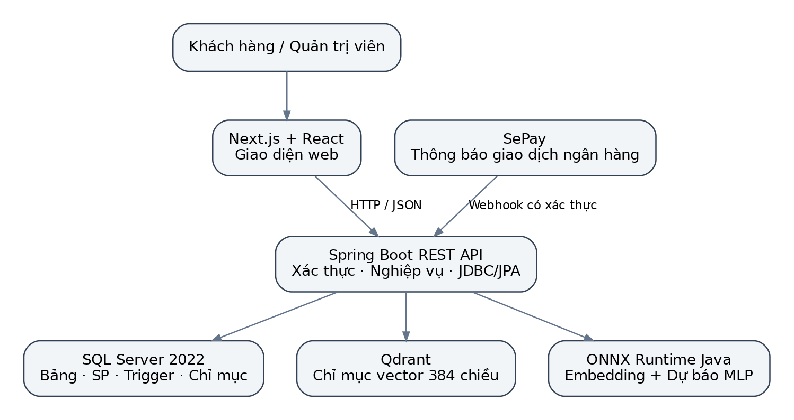
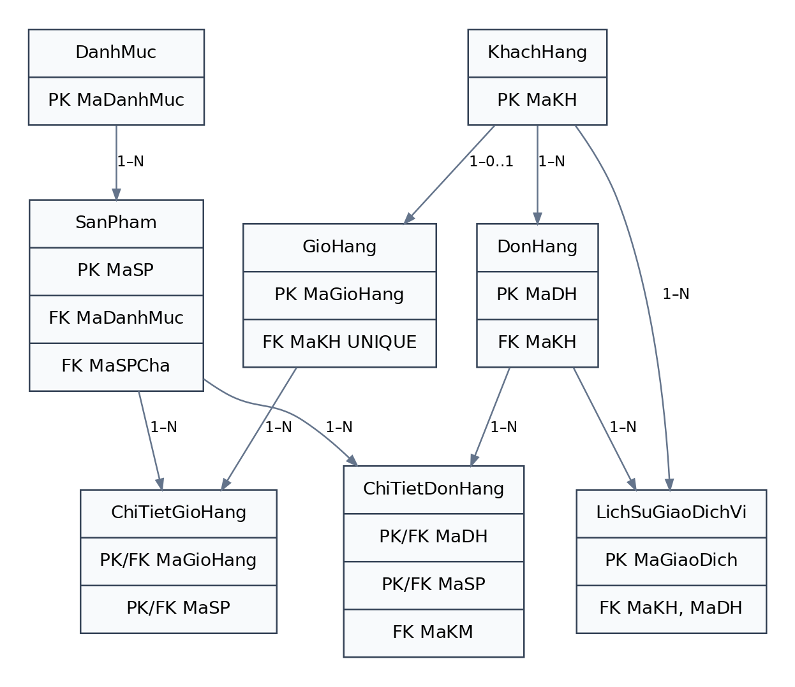
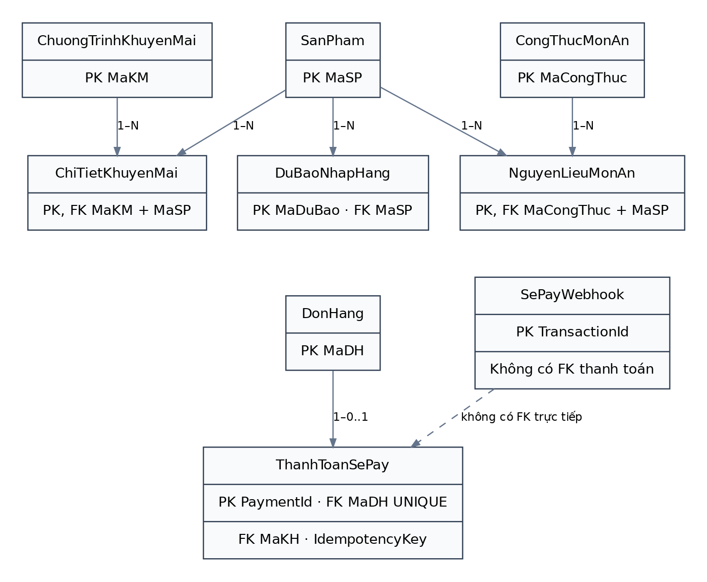
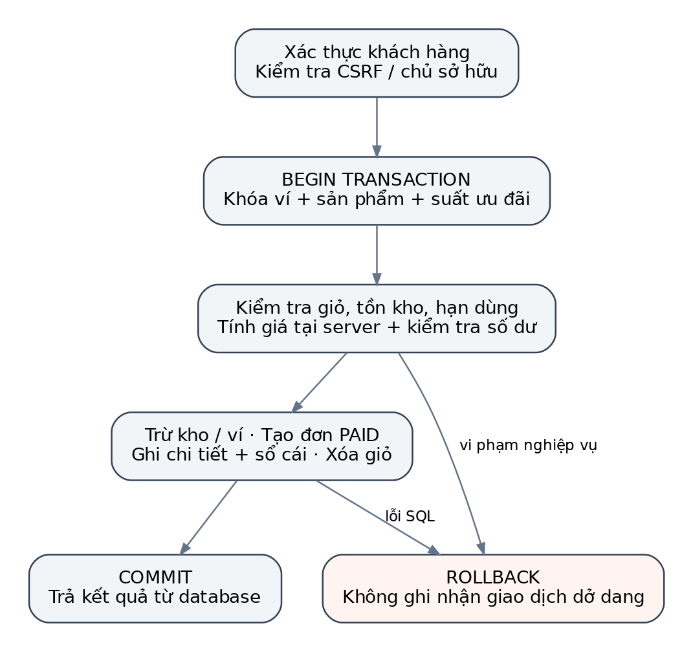
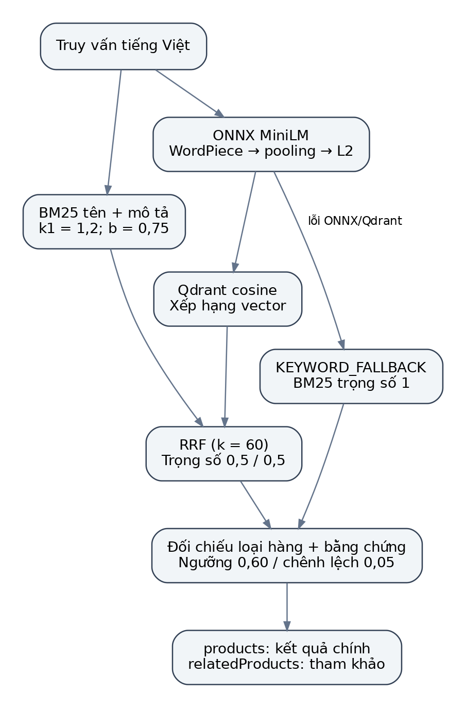
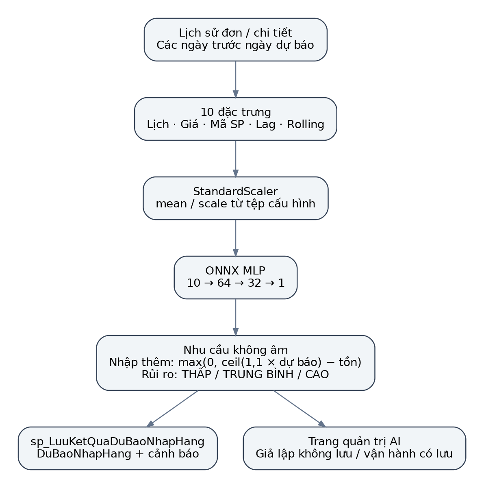
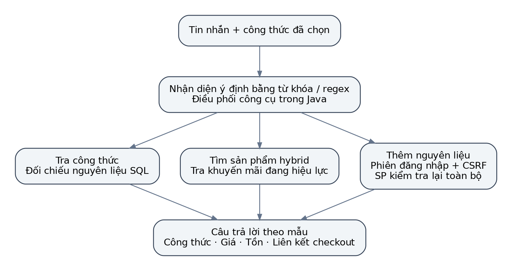
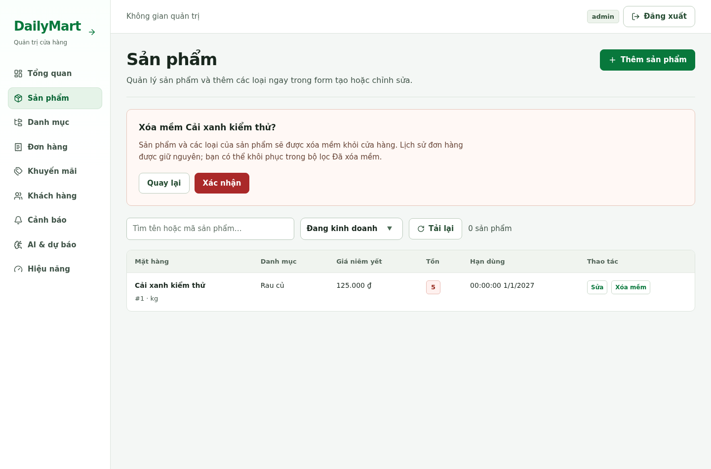
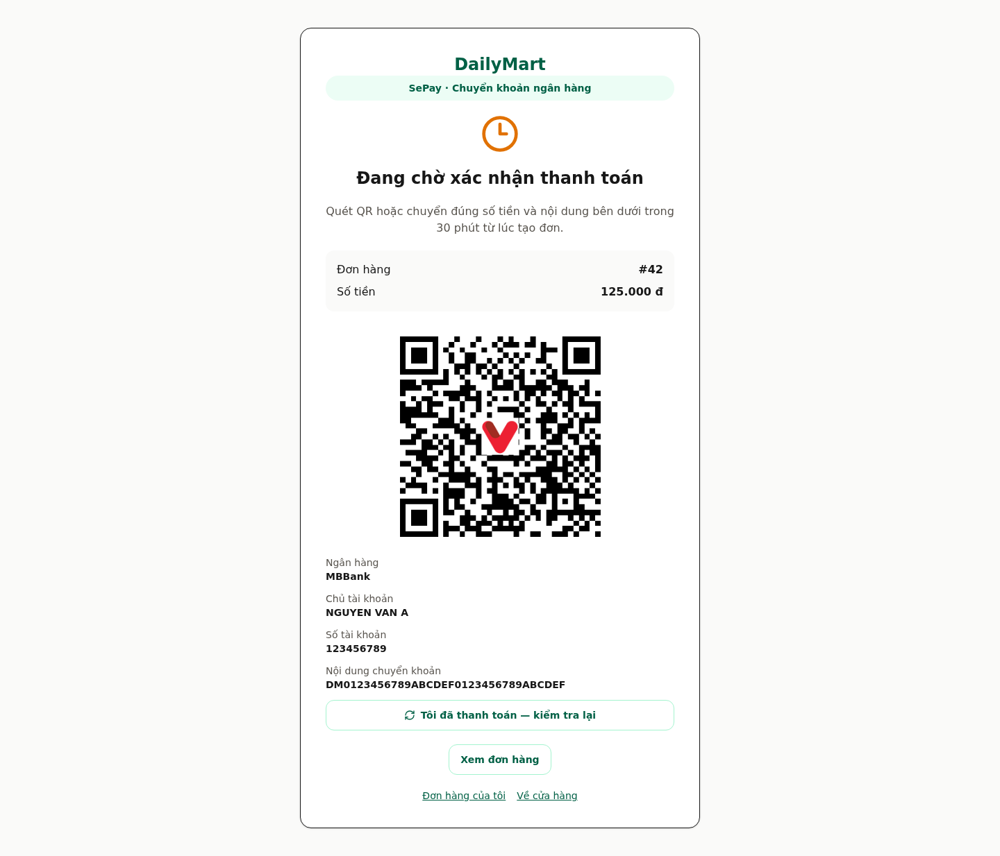
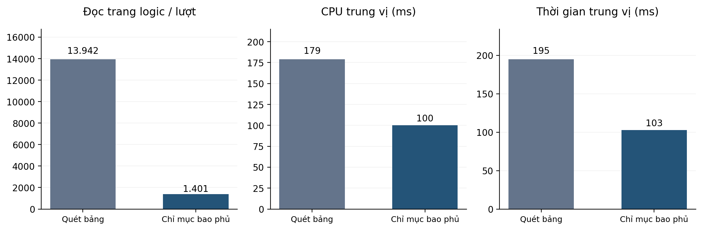

# TÓM TẮT

DailyMart là hệ thống quản lý và bán thực phẩm tươi sống được xây dựng cho học phần CT221H – Nguyên lý hệ quản trị cơ sở dữ liệu. Bài toán kết hợp quản lý danh mục, tồn kho và hạn sử dụng với giỏ hàng, thanh toán, khuyến mãi và hỗ trợ lựa chọn nguyên liệu. SQL Server lưu dữ liệu nghiệp vụ; stored procedure thực hiện các thao tác chính, trigger kiểm soát cập nhật và xóa mềm, còn giao dịch và chỉ mục hỗ trợ tính nhất quán và truy vấn báo cáo. Hệ thống sử dụng Next.js cho giao diện, Spring Boot cho API, Qdrant cho truy vấn vector và ONNX Runtime Java cho embedding cũng như dự báo nhu cầu. Chatbot điều phối công cụ theo các kịch bản được lập trình và truy xuất dữ liệu trong hệ thống.

Minh chứng đã lưu cho thấy chỉ mục bao phủ giảm số lần đọc trang logic từ 13.942 xuống 1.401 trên 500.000 đơn hàng, tương ứng 89,95%; thời gian trung vị giảm từ 195 ms xuống 103 ms. Tệp đánh giá mô hình dự báo ghi MAE 3,2161 đơn vị và WAPE 5,34% trên 860 mẫu mô phỏng. Các kết quả này phản ánh phạm vi thử nghiệm, chưa đại diện cho vận hành cửa hàng thực. Báo cáo mô tả hiện thực, phân tích các giới hạn của đánh giá và đề xuất bổ sung view vì các script khởi tạo được rà soát chưa định nghĩa đối tượng này. Luồng SePay mới có kiểm thử thành phần nhưng chưa kiểm thử thanh toán ngân hàng thực trong đợt cập nhật báo cáo.

**Từ khóa:** SQL Server; thủ tục lưu; trigger; giao dịch ACID; chỉ mục bao phủ; tìm kiếm ngữ nghĩa; dự báo nhu cầu; chatbot; DailyMart.

# CHƯƠNG 1. GIỚI THIỆU VÀ PHÂN TÍCH YÊU CẦU

## 1.1. Bối cảnh và lý do chọn đề tài

Thực phẩm tươi sống có vòng đời ngắn, giá bán thay đổi và đơn vị tính không đồng nhất. Cửa hàng cần biết sản phẩm còn đủ điều kiện bán hay không, số lượng có thể cung cấp và mức ưu đãi còn hiệu lực tại thời điểm khách thanh toán. Một danh mục hiển thị đúng ở trình duyệt chưa đủ bảo đảm tính hợp lệ của giao dịch, vì tồn kho và số dư có thể thay đổi trong lúc nhiều người mua cùng lúc.

Bài toán tạo điều kiện vận dụng các nội dung của học phần: thiết kế quan hệ, ràng buộc toàn vẹn, view, stored procedure, trigger, giao dịch, khóa và chỉ mục. Các chức năng AI được đặt bên cạnh dữ liệu nghiệp vụ để hỗ trợ tìm kiếm và quyết định nhập hàng. Trong kiến trúc này, kết quả mô hình không thay thế việc kiểm tra điều kiện bán và tính tiền trong cơ sở dữ liệu.

DailyMart được chọn làm bối cảnh triển khai vì liên kết được nghiệp vụ thương mại điện tử với các tình huống cần kiểm soát ở tầng dữ liệu: ngăn âm kho, ngăn âm ví, giữ lịch sử đơn khi ngừng bán sản phẩm, giới hạn suất khuyến mãi và phân biệt doanh thu thực với dữ liệu giả lập. Cấu trúc hệ thống và yêu cầu ban đầu được mô tả trong SRS của dự án [1].

## 1.2. Mục tiêu đề tài

Mục tiêu tổng quát là xây dựng một hệ thống web bán thực phẩm tươi sống có cơ sở dữ liệu quan hệ làm trung tâm, thể hiện được cách xử lý nghiệp vụ và bảo vệ dữ liệu trong hệ quản trị cơ sở dữ liệu. Kết quả mong đợi không chỉ là giao diện thực hiện được thao tác CRUD mà còn giải thích được vì sao một thay đổi được chấp nhận hoặc bị từ chối tại tầng dữ liệu.

Các mục tiêu cụ thể gồm: thiết kế bảng và quan hệ cho sản phẩm, khách hàng, giỏ hàng và đơn hàng; hiện thực các thủ tục lưu và trigger; tổ chức thanh toán có rollback; đo tác động của chỉ mục bằng kế hoạch thực thi; kết hợp tìm kiếm từ khóa và vector; đưa mô hình dự báo vào Java; xây dựng chatbot hỗ trợ chọn món và thêm nguyên liệu. Phần view được trình bày dưới dạng thiết kế bổ sung có SQL cụ thể, không được tính là chức năng đã triển khai trong bản mã nguồn được rà soát.

## 1.3. Tác nhân và phạm vi sử dụng

Bảng 1.1 xác định các tác nhân chính và giới hạn trách nhiệm. Khách hàng thao tác qua phiên đăng nhập của mình; quản trị viên có quyền quản lý nhưng không được bỏ qua quy tắc thanh toán để tùy ý tạo trạng thái đã trả tiền.

@Table Bảng 1.1. Tác nhân và trách nhiệm
| Tác nhân | Nghiệp vụ chính | Giới hạn |
| --- | --- | --- |
| Khách hàng | Tra cứu hàng, quản lý giỏ, xem công thức, thanh toán, xem đơn và ví | Chỉ truy cập giỏ, ví và đơn thuộc tài khoản |
| Quản trị viên | Quản lý danh mục, sản phẩm, khuyến mãi, cảnh báo và dự báo | Yêu cầu vai trò ADMIN; thao tác ghi phải có CSRF |
| SePay | Gửi thông báo giao dịch ngân hàng về backend | Chỉ webhook có khóa hợp lệ mới được xử lý |
| Dịch vụ ONNX và Qdrant | Sinh biểu diễn vector, xếp hạng ứng viên, suy luận nhu cầu | Không có quyền tự xác nhận thanh toán |

Phạm vi hiện tại là bản đồ án minh họa cho một cửa hàng, không mô hình hóa đầy đủ chuỗi cung ứng, nhiều chi nhánh, nhiều lô hàng hay quy trình kế toán. Ví DailyMart là ví nội bộ phục vụ mô phỏng nghiệp vụ. Luồng SePay bổ sung khả năng nhận thông báo chuyển khoản nhưng cần cấu hình tài khoản, khóa và endpoint công khai trước khi sử dụng.

## 1.4. Yêu cầu chức năng

Các nhóm yêu cầu trong Bảng 1.2 được rút từ SRS và đối chiếu lại với lớp controller, service và script SQL hiện tại. Bảng phân biệt yêu cầu với trạng thái hiện thực để tránh coi mọi nội dung trong tài liệu thiết kế ban đầu đều đã hoàn thành.

@Table Bảng 1.2. Ma trận yêu cầu và hiện thực
| Mã | Nhóm yêu cầu | Hiện thực hoặc vị trí minh chứng |
| --- | --- | --- |
| FR01 | Quản lý sản phẩm và loại sản phẩm | ProductController, ProductServiceImpl, ProductTypeService; thủ tục CRUD |
| FR02 | Xóa mềm và khôi phục | sp_XoaSanPham; trigger INSTEAD OF DELETE; API quản trị khôi phục |
| FR03 | Giỏ hàng, thanh toán ví và lịch sử | Thủ tục giỏ hàng, sp_ThanhToanDonHang và LichSuGiaoDichVi |
| FR04 | Khuyến mãi theo thời gian và số lượng | ChuongTrinhKhuyenMai, ChiTietKhuyenMai; kiểm tra suất khi thanh toán |
| FR05 | Nhật ký và cảnh báo | Trigger cập nhật, xóa mềm, kiểm soát giá; trang cảnh báo quản trị |
| FR06 | View phục vụ đọc và tổng hợp | Thiết kế bổ sung tại mục 3.6 và phụ lục C; chưa tích hợp khởi tạo |
| FR07 | Tìm kiếm ngữ nghĩa | BM25 + MiniLM ONNX + Qdrant + RRF; hai nhóm kết quả |
| FR08 | AI dự báo nhu cầu | MLP ONNX, 10 đặc trưng; lưu dự báo qua stored procedure |
| FR09 | Chatbot và nguyên liệu món ăn | Bộ điều phối kịch bản, bốn công cụ, thủ tục thêm nguyên liệu |
| FR10 | Tối ưu và đo hiệu năng truy vấn | Chỉ mục bao phủ; measurements.csv và kế hoạch thực thi |
| FR11 | Thanh toán chuyển khoản SePay | Tạo QR, xác thực webhook, chống trùng và hết hạn giữ hàng |

## 1.5. Yêu cầu phi chức năng

Tính đúng đắn dữ liệu được ưu tiên ở các đường ghi: giá và tồn kho phải được tính lại tại server; số dư và lịch sử ví phải cập nhật cùng giao dịch; đơn chưa nhận được xác nhận hợp lệ không được xem là đã trả tiền. Khi không đủ hàng hoặc điều kiện nghiệp vụ không còn hợp lệ, ứng dụng cần trả lỗi có ý nghĩa thay vì để dữ liệu ở trạng thái dở dang.

Khả năng quan sát thể hiện qua nhật ký trước và sau cập nhật, lịch sử giao dịch ví, lịch sử dự báo và kết quả xử lý webhook. Khả năng bảo trì thể hiện qua phân tầng controller–service–repository và các script có thể chạy lại. Đối với giao diện, các chức năng mua hàng và quản trị được kiểm tra ở nhiều chiều rộng màn hình trong các đợt QA đã lưu [2].

Các mục tiêu hiệu năng trong SRS là tiêu chí cần kiểm chứng, không phải kết quả mặc định của kiến trúc. Mục 8.3 trình bày trường hợp benchmark chưa đạt trọn vẹn mục tiêu giảm đọc trang ít nhất 90% và thời gian dưới 100 ms. Chưa có phép thử tải dài hạn đủ để đưa ra năng lực phục vụ đồng thời cho môi trường thật.

## 1.6. Phương pháp thực hiện và phạm vi bằng chứng

Báo cáo được xây dựng bằng cách đối chiếu tài liệu yêu cầu với script SQL, lớp Java, mã giao diện, notebook và các báo cáo JSON/CSV đã lưu. Số liệu benchmark được tính từ measurements.csv; số liệu mô hình triển khai lấy từ scaler_params.json; kết quả tìm kiếm lấy từ hybrid-main-report.json. Nguồn bằng chứng được liệt kê cụ thể ở phụ lục A.

Mốc rà soát là ngày 14/11/2026. Những số liệu ghi ngày 07/11 hoặc 10/11 được giữ như kết quả lịch sử, không được mô tả thành phép đo mới. Các ảnh giao diện SePay và xóa mềm được chụp với dữ liệu kiểm thử giả lập nhằm minh họa cách sử dụng, không chứng minh kết nối ngân hàng hay database vận hành đã thành công.

# CHƯƠNG 2. CƠ SỞ KỸ THUẬT VÀ KIẾN TRÚC HỆ THỐNG

## 2.1. Cơ sở dữ liệu quan hệ và phân chia trách nhiệm

SQL Server quản lý các đối tượng có quan hệ chặt chẽ như khách hàng, sản phẩm, đơn và lịch sử ví. Khóa chính định danh từng bản ghi; khóa ngoại giữ liên kết; CHECK, UNIQUE và NOT NULL biểu diễn những điều kiện dữ liệu có thể kiểm tra ở mức bảng. Ví dụ, một giỏ hàng không có hai dòng trùng sản phẩm vì chi tiết giỏ dùng khóa ghép (MaGioHang, MaSP).

Stored procedure đóng gói chuỗi câu lệnh và các tham số trả về; trigger phản ứng với sự kiện thay đổi dữ liệu. View tạo giao diện truy vấn trên dữ liệu hiện có, phù hợp cho việc tái sử dụng bộ lọc và phép tổng hợp [8], [9], [10]. Trong hệ thống, mỗi loại đối tượng có vai trò riêng: ràng buộc chặn dữ liệu không hợp lệ, thủ tục tổ chức nghiệp vụ và trigger ghi nhận hoặc kiểm soát thay đổi ở các điểm được chỉ định.

Dữ liệu vector trong Qdrant là chỉ mục phục vụ tìm kiếm, còn SQL Server là nguồn dữ liệu nghiệp vụ. Một kết quả có độ tương đồng cao vẫn phải được đối chiếu với sản phẩm hiện còn hoạt động và giá thực tế. Mô hình dự báo tạo đề xuất; việc nhập hàng hay điều chỉnh ưu đãi vẫn là quyết định quản trị.

## 2.2. Kiến trúc phân tầng

Hình 2.1 mô tả các thành phần đang có trong hệ thống. Giao diện gọi API để lấy và thay đổi dữ liệu, không kết nối trực tiếp SQL Server. Backend gọi thủ tục lưu qua SimpleJdbcCall hoặc thực hiện câu lệnh JDBC/JPA tùy phân hệ. ONNX Runtime chạy suy luận trong JVM, còn Qdrant cung cấp truy vấn vector thông qua dịch vụ riêng.



Controller chịu trách nhiệm ánh xạ endpoint, kiểm tra định dạng request và sử dụng cơ chế xác thực. Service phối hợp nghiệp vụ, gọi công cụ tìm kiếm hoặc mô hình, đồng thời chuyển kết quả sang DTO. Repository và các thành phần JDBC thực hiện truy cập dữ liệu; các thủ tục SQL tiếp tục kiểm tra điều kiện ở thời điểm thao tác thực sự được ghi nhận.

Cách phân tầng này giúp giữ giao diện độc lập tương đối với schema vật lý. Tuy nhiên, logic nghiệp vụ hiện phân bố ở cả Java và T-SQL. Khi sửa quy tắc giá, hạn dùng hoặc khuyến mãi cần kiểm tra đồng thời các đường đi giỏ hàng, thanh toán ví, thanh toán SePay và thêm nguyên liệu món ăn để tránh lệch hành vi.

## 2.3. Công nghệ sử dụng

Bảng 2.1 ghi các phiên bản từ manifest và cấu hình của dự án. Những phiên bản này phản ánh bộ mã hiện tại, không phải khuyến nghị cập nhật công nghệ.

@Table Bảng 2.1. Thành phần công nghệ
| Thành phần | Công nghệ trong dự án | Vai trò |
| --- | --- | --- |
| Giao diện | Next.js 16.4.2, React 19.3.0, TypeScript, Tailwind CSS | Cửa hàng, thanh toán và trang quản trị |
| Backend | Java 21, Spring Boot 3.3.4, Spring Security | REST API, phiên đăng nhập, điều phối nghiệp vụ |
| Dữ liệu quan hệ | Microsoft SQL Server 2022 Developer trong cấu hình Docker | Lưu trữ, T-SQL, giao dịch và kế hoạch thực thi |
| Truy cập SQL | Spring JDBC, SimpleJdbcCall, Spring Data JPA | Gọi thủ tục và truy vấn dữ liệu |
| Tìm kiếm vector | Qdrant; collection fresh_grocery_products | Lưu vector 384 chiều và truy vấn cosine |
| Suy luận | ONNX Runtime Java 1.18.0 | Embedding MiniLM và mô hình MLP dự báo |
| Huấn luyện | Python, PyTorch, scikit-learn; notebook có LightGBM và XGBoost | Tạo dữ liệu mô phỏng, đặc trưng và thử mô hình |
| Thanh toán mới | SePay webhook, QR chuyển khoản | Đối soát tiền vào theo mã thanh toán |
| Kiểm thử | JUnit, Mockito, Spring test; Node test, TypeScript, ESLint | Kiểm tra nghiệp vụ, API và giao diện |

SRS ban đầu nhắc tới Spring AI và tích hợp MCP. Khi đối chiếu pom.xml và các lớp hiện thực, chatbot hiện điều phối công cụ trực tiếp bằng Java; chưa có căn cứ để mô tả nó như một tác tử LLM gọi mô hình hội thoại bên ngoài hoặc một MCP server chuẩn đã được kiểm thử tương thích đầy đủ.

## 2.4. Giao dịch, khóa và ACID

Trong báo cáo, ACID được hiểu qua bốn thuộc tính: nguyên tử, nhất quán, cô lập và bền vững. Thuộc tính nguyên tử thể hiện khi các thay đổi của một lần thanh toán được commit hoặc rollback cùng nhau. Tính nhất quán phụ thuộc cả ràng buộc bảng và điều kiện nghiệp vụ. Cô lập được hỗ trợ bằng giao dịch và khóa; bền vững do cơ chế ghi log và lưu trữ của hệ quản trị cung cấp khi cấu hình, vận hành phù hợp.

Mã nguồn dùng UPDLOCK để đọc theo hướng chuẩn bị cập nhật, ROWLOCK để yêu cầu ưu tiên khóa dòng và HOLDLOCK ở một số truy vấn cần giữ khóa trong giao dịch. ROWLOCK là gợi ý khóa, không phải chứng minh rằng sẽ không có nâng cấp khóa hay deadlock. Muốn đánh giá đồng thời cần thử các tình huống tranh chấp với cùng tài nguyên và kiểm tra bất biến sau giao dịch.

## 2.5. An toàn truy cập và giới hạn triển khai

Khách hàng được ràng buộc bằng phiên đăng nhập; các thao tác ghi kiểm tra CSRF và mã chủ sở hữu. Mật khẩu khách hàng lưu dạng BCrypt trong bảng đăng nhập bổ sung. Quản trị viên được kiểm tra vai trò ADMIN. Endpoint nạp ví yêu cầu quyền quản trị và ghi sổ cái; khách hàng không được tự gọi thao tác này.

Webhook SePay là điểm nhận thông báo server–server nên không dựa vào phiên trình duyệt; nó xác thực bằng khóa riêng. Tính đúng đắn của trạng thái thanh toán không được suy ra từ tham số trên URL trang kết quả. Các cấu hình mẫu trong repository phục vụ phát triển; trước vận hành cần thay thông tin bí mật, giới hạn quyền database và thiết lập HTTPS, sao lưu, theo dõi lỗi.

# CHƯƠNG 3. THIẾT KẾ CƠ SỞ DỮ LIỆU VÀ VIEW

## 3.1. Nhóm thực thể và quan hệ

Schema khởi tạo định nghĩa 15 bảng nghiệp vụ chính. Các thành phần Java bổ sung bảng đăng nhập khách hàng, bảng thanh toán MoMo lịch sử và hai bảng SePay. Vì vậy không sử dụng nguyên số lượng “13 bảng” trong mô tả SRS cũ làm số lượng hiện tại. Các hình dưới trình bày quan hệ theo nhóm, còn phụ lục B liệt kê trường dữ liệu từ script.



DanhMuc liên kết một–nhiều với SanPham. KhachHang liên kết tối đa một giỏ hàng thông qua MaKH UNIQUE trong GioHang, nhưng có thể có nhiều đơn hàng và nhiều giao dịch ví. Các bảng ChiTietGioHang, ChiTietDonHang và NguyenLieuMonAn biểu diễn quan hệ nhiều–nhiều bằng khóa ghép. SanPham có MaSPCha để biểu diễn các loại của cùng một sản phẩm.



ThanhToanSePay có một mã thanh toán và một MaDH duy nhất. SePayWebhook lưu thông báo theo TransactionId; quan hệ với thanh toán được suy ra từ payload và mã nội dung chuyển khoản, không có khóa ngoại trực tiếp. NhatKyCanhBao lưu MaSP phục vụ truy vết nhưng cột này trong script gốc không được khai báo thành khóa ngoại.

## 3.2. Từ điển dữ liệu nghiệp vụ chính

Bảng 3.1 tóm tắt các thực thể thường xuyên tham gia giao dịch. Các trường tiền tệ dùng DECIMAL để biểu diễn số thập phân chính xác; việc tính tiền phía Java sử dụng BigDecimal. Số lượng bán trong giỏ và đơn hiện là số nguyên, dù định lượng công thức có thể là số thập phân.

@Table Bảng 3.1. Các bảng và quy tắc dữ liệu chủ yếu
| Bảng | Khóa và trường chính | Quy tắc đáng chú ý |
| --- | --- | --- |
| DanhMuc | MaDanhMuc; TenDanhMuc | Tên danh mục duy nhất |
| SanPham | MaSP; MaSPCha; Gia; SoLuongTon; HanSuDung | Gia > 0; tồn không âm; xóa mềm bằng TrangThaiXoa |
| KhachHang | MaKH; Email; SoDienThoai; SoDuVi | Email và số điện thoại duy nhất; số dư không âm |
| GioHang | MaGioHang; MaKH | Một giỏ cho mỗi khách hàng |
| ChiTietGioHang | (MaGioHang, MaSP); SoLuong | Số lượng > 0; liên kết sản phẩm và giỏ |
| DonHang | MaDH; MaKH; TongTien; TrangThai; NguonDon | Tổng không âm; trạng thái thuộc miền quy định |
| ChiTietDonHang | (MaDH, MaSP); DonGia; GiaGoc; TienGiam; MaKM | Lưu giá và ưu đãi tại thời điểm giao dịch |
| LichSuGiaoDichVi | MaGiaoDich; MaKH; MaDH; các số dư | Lưu biến động thanh toán, nạp hoặc hoàn tiền |
| DuBaoNhapHang | MaDuBao; MaSP; NgayDuBao; nhu cầu và đề xuất | Nhu cầu và lượng nhập không âm; rủi ro ba mức |

NguonDon phân biệt SALE, DEMO_FORECAST và BENCHMARK. Đây là một phần của thiết kế dữ liệu chứ không chỉ là nhãn trên giao diện. Nếu bỏ qua điều kiện nguồn khi tổng hợp doanh thu, các đơn sinh để thử hiệu năng hoặc tạo lịch sử AI có thể bị cộng nhầm vào kết quả bán hàng.

## 3.3. Chuẩn hóa và dữ liệu lịch sử

Thiết kế tách danh mục, sản phẩm, khách hàng, đơn và các dòng chi tiết để hạn chế lặp dữ liệu có cùng vòng đời. Danh sách sản phẩm không được lưu thành chuỗi trong DonHang; mỗi mặt hàng là một dòng ChiTietDonHang. Tương tự, nguyên liệu món ăn được tách thành bảng liên kết và có định lượng riêng.

Các thuộc tính DonGia, GiaGoc và TienGiam trong chi tiết đơn là ảnh chụp nghiệp vụ tại thời điểm bán. Chúng có thể trùng với một giá trị hiện tại trong SanPham nhưng không có nghĩa là phải suy ngược giá đơn từ bảng sản phẩm. Nếu giá niêm yết đổi sau đó, lịch sử tài chính của đơn cũ vẫn cần giữ giá đã thanh toán.

Việc giữ SoDuVi song song với sổ cái giao dịch hỗ trợ truy cập số dư nhanh nhưng tạo thêm yêu cầu đối soát. Hai phần phải được cập nhật trong cùng giao dịch; trường hợp thao tác trực tiếp database ngoài luồng ứng dụng có thể phá vỡ bất biến này. Báo cáo không xem sự tồn tại của bảng lịch sử là bằng chứng tự động rằng mọi cập nhật đều đã được kiểm soát.

## 3.4. Ràng buộc toàn vẹn

Ràng buộc miền kiểm tra giá dương, số lượng dương hoặc không âm, thời gian kết thúc khuyến mãi không sớm hơn thời gian bắt đầu và trạng thái đơn hợp lệ. Ràng buộc tham chiếu liên kết đơn với khách hàng, chi tiết với đơn và sản phẩm. UNIQUE bảo vệ danh tính khách, một giỏ cho mỗi khách và tính duy nhất của mã giao dịch bên ngoài.

Một số điều kiện phụ thuộc nhiều bảng và thời điểm không thể chỉ viết thành CHECK đơn giản: sản phẩm còn hạn khi mua, khuyến mãi còn suất cho toàn bộ lượng mua, số dư đủ cho tổng đơn. Các điều kiện này được kiểm tra trong thủ tục hoặc giao dịch ở service khi đã nắm khóa phù hợp. Vì vậy một request hợp lệ ở tầng biểu mẫu vẫn có thể bị từ chối lúc thanh toán nếu tài nguyên đã thay đổi.

## 3.5. Sản phẩm cha, loại sản phẩm và xóa mềm

SanPham biểu diễn cả sản phẩm gốc và các loại thông qua MaSPCha. Tên loại đang hoạt động được bảo vệ bằng chỉ mục duy nhất có bộ lọc trên (MaSPCha, TenLoai). Cách thiết kế này hỗ trợ quản lý nhiều quy cách nhưng cần thống nhất cách chọn sản phẩm mua được giữa danh mục, tìm kiếm, giỏ hàng và dự báo.

Khi quản trị viên xóa mềm sản phẩm cha, ProductServiceImpl gọi thủ tục xóa cho bản ghi cha và các loại đang hoạt động, đồng thời yêu cầu gỡ các mục tương ứng khỏi chỉ mục tìm kiếm. Thao tác này giữ lại các bản ghi để các dòng đơn cũ tiếp tục truy vết được. Bộ lọc “Đã xóa mềm” và thao tác “Khôi phục” giúp quản trị viên phục hồi khi cần; trước bán lại vẫn phải kiểm tra tồn kho và hạn dùng.

## 3.6. Thiết kế view phục vụ khai thác dữ liệu

View là kết quả truy vấn được định nghĩa bằng một đối tượng SQL, giúp tập trung cách đọc dữ liệu dùng lặp lại [8]. Trong phần rà soát ngày 14/11/2026 chưa tìm thấy CREATE VIEW trong các script ứng dụng. Bảng 3.2 vì vậy là thiết kế bổ sung của báo cáo; SQL đầy đủ nằm tại CT221H_assets/views_de_xuat.sql, chưa được gọi bởi init_db.sh và chưa được chạy kiểm thử SQL Server trong đợt viết báo cáo.

@Table Bảng 3.2. Các view đề xuất và mục đích
| View đề xuất | Nguồn dữ liệu | Ngữ nghĩa |
| --- | --- | --- |
| vw_SanPhamConHieuLuc | SanPham, DanhMuc | Từng dòng sản phẩm chưa xóa, còn hạn và còn tồn; không thay logic chọn loại trên ứng dụng |
| vw_DoanhThuBanTheoNgay | DonHang | Tổng số đơn và doanh thu SALE ở trạng thái PAID/DELIVERED theo ngày tạo |
| vw_TongHopMuaHangKhachHang | KhachHang LEFT JOIN DonHang | Số đơn, tổng chi tiêu và lần mua gần nhất; vẫn giữ khách chưa mua |
| vw_DuBaoMoiNhatTheoSanPham | DuBaoNhapHang | Bản ghi theo ngày dự báo mới nhất; xử lý hòa bằng thời gian tạo và mã dự báo |

Ví dụ dưới đây mô tả định nghĩa doanh thu theo ngày. Điều kiện NguonDon loại dữ liệu thử khỏi phép tính; điều kiện trạng thái không cộng đơn chờ hoặc hủy. Đây là tổng giá trị đơn theo ngày tạo, chưa phải sổ doanh thu kế toán theo ngày nhận tiền.

```sql
CREATE OR ALTER VIEW dbo.vw_DoanhThuBanTheoNgay
AS
SELECT CAST(NgayTao AS date) AS Ngay,
       COUNT_BIG(*) AS SoDon,
       SUM(TongTien) AS DoanhThu
FROM dbo.DonHang
WHERE NguonDon = 'SALE'
  AND TrangThai IN ('PAID', 'DELIVERED')
GROUP BY CAST(NgayTao AS date);
```

Khi truy vấn view, ứng dụng vẫn cần chỉ định ORDER BY nếu muốn thứ tự ổn định. Các view này không được mô tả là indexed view và không mặc định tăng tốc. Muốn tích hợp cần chạy trên database QA, so sánh với truy vấn gốc, thử đơn không có chi tiết, khách chưa mua và các trường hợp cùng ngày dự báo trước khi chuyển đường đọc của ứng dụng sang view.

## 3.7. Kế hoạch kiểm chứng phần view

Dữ liệu kiểm thử cần có ít nhất ba nguồn đơn, đủ bốn trạng thái và một khách chưa từng mua. Kết quả vw_DoanhThuBanTheoNgay phải loại DEMO_FORECAST, BENCHMARK, PENDING và CANCELLED; tổng các nhóm ngày phải bằng truy vấn đối chứng có cùng bộ lọc. View khách hàng phải trả số đơn bằng 0 cho khách chưa mua thay vì làm mất dòng khách đó.

Đối với view dự báo mới nhất, cần tạo nhiều bản ghi cho cùng sản phẩm và cùng ngày, sau đó xác định kết quả bằng thứ tự NgayDuBao, NgayTao và MaDuBao. View hiệu lực sản phẩm cần thử riêng sản phẩm cha và loại con, vì “một dòng còn tồn” không đồng nghĩa cấu trúc nhóm sản phẩm trên giao diện đã có giá hoặc loại mặc định phù hợp. Đây là các tiêu chí nghiệm thu đề xuất, chưa phải kết quả test đã đạt.

# CHƯƠNG 4. HIỆN THỰC T-SQL VÀ KIỂM SOÁT NGHIỆP VỤ

## 4.1. Tổ chức stored procedure

Các thủ tục được khai báo chủ yếu trong database/02_stored_procedures.sql. Giao diện tham số tách dữ liệu vào với mã trạng thái, thông báo và mã đối tượng được tạo. Tầng Java gọi các thủ tục qua những repository chuyên biệt, chẳng hạn ProductSpRepository và ForecastSpRepository. Các mã lỗi nghiệp vụ không được đồng nhất với việc kết nối SQL thành công: một lời gọi hoàn tất vẫn có thể trả StatusCode âm để từ chối thao tác.

Bảng 4.1 nhóm các thủ tục thực tế theo chức năng. Ngoài tập này, sp_SinhDuLieuLonBenchmark và sp_BenchmarkBaoCaoDoanhThu nằm trong script hiệu năng. Một số script bổ sung điều chỉnh định nghĩa thủ tục theo phiên bản schema, do đó khi tái hiện phải kiểm tra cả thứ tự khởi tạo thay vì chỉ chạy một đoạn SQL tách rời.

@Table Bảng 4.1. Các stored procedure chính trong dự án
| Nhóm | Tên thủ tục | Trách nhiệm |
| --- | --- | --- |
| Sản phẩm | sp_ThemSanPhamMoi; sp_CapNhatSanPham | Kiểm tra dữ liệu và ghi thông tin sản phẩm |
| Đọc và xóa | sp_LayDanhSachSanPhamPhanTrang; sp_LayChiTietSanPham; sp_XoaSanPham | Duyệt, xem chi tiết và kích hoạt xóa mềm |
| Ví | sp_NapTienVi | Cập nhật số dư và lịch sử giao dịch |
| Giỏ hàng | sp_ThemVaoGioHang; sp_XoaKhoiGioHang; sp_LayGioHangKhachHang | Kiểm tra lượng mua, cập nhật và tính giỏ |
| Thanh toán | sp_ThanhToanDonHang | Giao dịch ví, tồn kho, đơn và sổ cái |
| Dự báo | sp_LayLichSuBanHangHuanLuyen; sp_LuuKetQuaDuBaoNhapHang | Đọc lịch sử, lưu kết quả và ghi cảnh báo phù hợp |
| Công thức | sp_ThemNguyenLieuMonAnVaoGioHang | Tính khẩu phần, kiểm tra nguyên liệu và thêm giỏ |
| Khuyến mãi | sp_TaoChuongTrinhKhuyenMai; sp_ThemSanPhamVaoKhuyenMai | Tạo chương trình, gắn mặt hàng ưu đãi |
| Xả kho | sp_TuDongKichHoatXaKhoCanDate | Tạo hoặc áp dụng kịch bản xả kho hàng cận hạn |

Không phải mọi đường truy cập database đều đi qua stored procedure. Ví dụ, quản trị tổng hợp có truy vấn JDBC, tìm kiếm từ khóa tính BM25 ở Java và phân hệ SePay mới dùng giao dịch JdbcTemplate. Vì vậy báo cáo chỉ khẳng định CRUD sản phẩm và các nghiệp vụ nêu trên có thủ tục, không khẳng định toàn hệ thống không có SQL trực tiếp.

## 4.2. CRUD sản phẩm qua thủ tục lưu

Khi thêm sản phẩm, backend kiểm tra request trước, sau đó thủ tục kiểm tra lại các điều kiện như giá dương, lượng tồn không âm, hạn dùng và danh mục tồn tại. Sau khi thủ tục trả mã thành công, ứng dụng đọc dữ liệu đã ghi để trả response và đồng bộ chỉ mục tìm kiếm. Cập nhật sản phẩm tương tự nhưng còn tạo cơ hội cho trigger nhận diện biến động.

Đường duyệt danh mục không có từ khóa sử dụng thủ tục phân trang. Với từ khóa, mã hiện tại chuyển sang BM25 để có xếp hạng liên quan. Tính năng này khác mô tả LIKE trong SRS ban đầu; thao tác đọc bằng thủ tục vẫn tồn tại cho duyệt và chi tiết, nhưng không phải toàn bộ tìm kiếm sản phẩm đều được thực hiện trong stored procedure.

Đối với xóa, sp_XoaSanPham phát lệnh DELETE trên bản ghi đang hoạt động. Trigger INSTEAD OF DELETE thay việc xóa vật lý bằng cập nhật TrangThaiXoa. Cách kết hợp giữ được cả giao diện thao tác qua thủ tục lẫn minh họa trigger theo yêu cầu học phần. Đoạn trích dưới đây giữ nguyên ý nghĩa từ script hiện có.

```sql
DECLARE @DaXuLy TABLE (MaSP INT);
DELETE FROM dbo.SanPham
OUTPUT deleted.MaSP INTO @DaXuLy
WHERE MaSP = @MaSP AND TrangThaiXoa = 0;
SET @DaXoa = CASE WHEN EXISTS (
    SELECT 1 FROM @DaXuLy
) THEN 1 ELSE 0 END;
```

## 4.3. Thanh toán ví và giao dịch nguyên tử

Hình 4.1 thể hiện luồng xử lý của sp_ThanhToanDonHang. Sau kiểm tra giỏ hàng, thủ tục đọc và khóa thông tin ví, lấy sản phẩm và khuyến mãi phù hợp, kiểm tra tồn và hạn dùng rồi tính tổng. Điều kiện đủ suất khuyến mãi áp dụng cho toàn bộ lượng mua của mặt hàng, tránh chỉ thấy còn một suất rồi giảm giá cho nhiều đơn vị vượt giới hạn.



Trong phần ghi, thủ tục trừ tồn, trừ số dư, tạo DonHang ở trạng thái PAID, lưu ChiTietDonHang, tăng SoLuongDaBan của ưu đãi, ghi LichSuGiaoDichVi và xóa chi tiết giỏ. Những thay đổi này nằm giữa BEGIN TRANSACTION và COMMIT. Khi phát sinh lỗi hoặc vi phạm điều kiện nghiệp vụ, thủ tục rollback và trả mã lỗi thay vì để riêng một phần cập nhật tồn tại.

Các bất biến cần kiểm tra sau thanh toán gồm: tồn kho cuối không âm; số dư cuối bằng số dư đầu trừ tổng đơn; tổng đơn khớp tổng chi tiết; biến động ví khớp số tiền thanh toán; và giỏ chỉ được dọn sau thành công. Nếu một tình huống test chỉ xác nhận API trả HTTP 200 mà không kiểm tra các bảng này thì chưa đủ để đánh giá tính nhất quán.

Ví dụ minh họa, một giỏ gồm hai đơn vị hàng có đơn giá hợp lệ 35.000 đồng cần tổng 70.000 đồng. Nếu ví chỉ có 50.000 đồng, kết quả đúng là từ chối toàn bộ, không phải trừ trước tồn kho rồi báo thiếu tiền. Con số trong ví dụ chỉ giải thích nghiệp vụ, không phải một lượt đo thực nghiệm.

## 4.4. Tranh chấp đồng thời và giới hạn khóa

Hai khách cùng mua phần hàng còn lại tạo nguy cơ bán vượt tồn. Khóa trên dòng sản phẩm làm cho các giao dịch cần cập nhật cùng tài nguyên phải chờ hoặc bị từ chối theo trạng thái mới. Tương tự, đọc số dư theo hướng cập nhật giúp giảm nguy cơ hai thao tác cùng sử dụng một số dư cũ.

Mã nguồn có bài thử cạnh tranh và bộ test kiểm tra việc không để tồn hoặc ví âm. Báo cáo kiểm thử ngày 10/11 cũng ghi nhận việc sửa dữ liệu phản hồi bị cũ do entity JPA đã được nạp trước khi stored procedure cập nhật [2]. Điều này cho thấy ngoài khóa ghi, cần bảo đảm response sau giao dịch phản ánh dữ liệu mới, không lấy lại số dư từ bộ nhớ đệm của persistence context.

Các cơ chế trên không chứng minh hệ thống không có deadlock ở mọi tổ hợp thao tác. Đường thanh toán ví, giữ hàng SePay, hoàn ví và cập nhật khuyến mãi cần được đánh giá chung về thứ tự khóa. Khi vận hành phải có theo dõi deadlock, thời gian chờ và chiến lược retry phù hợp với tính lặp an toàn của yêu cầu.

## 4.5. Trigger cập nhật và nhật ký trước–sau

trg_SanPham_CanhBaoBienDong chạy AFTER UPDATE. Trigger dùng tập inserted và deleted để so sánh nhiều dòng theo MaSP; vì vậy phần xử lý chính không giả định một lệnh UPDATE chỉ tác động một sản phẩm. Bản ghi cập nhật lưu nội dung trước và sau ở dạng JSON để quản trị viên đối chiếu các trường nghiệp vụ.

Các cảnh báo chuyên biệt gồm hết hàng khi tồn cũ dương và tồn mới không còn dương; giá mới nhỏ hơn một nửa hoặc lớn hơn hai lần giá cũ; và hạn dùng còn không quá một ngày trong khi vẫn có tồn. Điều kiện giá “lớn hơn hai lần” tương đương giá mới vượt 200% giá cũ, không được diễn đạt nhầm thành “mức tăng trên 200%”.

Điều kiện cận hạn dựa trên thời điểm có UPDATE. Trigger này không phải tác vụ định kỳ tự chạy khi đồng hồ chuyển ngày; một sản phẩm không được cập nhật có thể không sinh cảnh báo chỉ vì ngày hết hạn đến gần. Muốn cảnh báo theo thời gian cần bổ sung lịch quét hoặc cơ chế tác vụ nền.

@Table Bảng 4.2. Trigger và sự kiện dữ liệu
| Trigger | Sự kiện | Kết quả |
| --- | --- | --- |
| trg_SanPham_CanhBaoBienDong | AFTER UPDATE trên SanPham | Nhật ký trước–sau; cảnh báo giá, tồn và cận hạn |
| trg_SanPham_NganChanXoaVatLy | INSTEAD OF DELETE trên SanPham | Đặt TrangThaiXoa=1, cập nhật thời gian và ghi nhật ký |
| trg_ChiTietKhuyenMai_KiemSoatGia | AFTER INSERT, UPDATE trên ChiTietKhuyenMai | Từ chối giá ưu đãi không thấp hơn giá gốc; tính phần trăm giảm |

## 4.6. Trigger xóa mềm và kiểm soát giá khuyến mãi

Trigger xóa mềm cập nhật những dòng khớp tập deleted, không thực hiện xóa vật lý các sản phẩm đó. Các tham chiếu từ đơn hàng vì vậy vẫn còn đối tượng để truy vết. Trigger cập nhật có kiểm tra mức lồng trigger để tránh ghi trùng nhật ký cập nhật chung cho thao tác xóa mềm đã có sự kiện riêng.

Trigger giá ưu đãi kiểm tra tập inserted và bảng SanPham. Nếu có GiaKhuyenMai lớn hơn hoặc bằng Gia, thao tác bị báo lỗi và rollback. Nếu hợp lệ, PhanTramGiam được tính theo (Gia − GiaKhuyenMai)/Gia × 100. Phần trăm là giá trị dẫn xuất từ giá và được đồng bộ khi dòng ưu đãi thay đổi.

Việc đặt quy tắc ở trigger giúp các đường ghi khác nhau cùng bị kiểm soát tại điểm dữ liệu thay đổi. Đổi lại, trigger làm tăng lượng công việc trong giao dịch và có thể tạo tác động gián tiếp khó nhìn thấy ở caller. Vì thế nội dung trigger cần gọn, xử lý theo tập và có test cập nhật nhiều dòng, lỗi giữa chừng và tương tác với trigger khác.

## 4.7. Chỉ mục và thiết kế phép đo

Chỉ mục IX_DonHang_NgayTao_TrangThai_Covering có khóa (NgayTao, TrangThai) và INCLUDE (MaKH, TongTien). Các cột bao phủ cung cấp thông tin cần cho phép tổng hợp mà không yêu cầu đọc bổ sung toàn bộ dòng đơn. Một chỉ mục lọc khác phục vụ trạng thái trả tiền cũng có trong script, nhưng không được nhập nhằng với chỉ mục dùng trong phép đo 500.000 dòng.

Phép đo lịch sử đối chiếu một truy vấn ép quét bằng INDEX(0) với một truy vấn ép dùng chỉ mục bao phủ; cả hai tính cùng kết quả theo cùng mốc thời gian và trạng thái. Đã làm nóng bộ đệm, cập nhật thống kê FULLSCAN, chạy luân phiên năm lượt mỗi cách, dùng MAXDOP 1 và RECOMPILE [3]. Kết quả là bằng chứng có kiểm soát của hai kế hoạch, không phải chứng minh optimizer sẽ chọn giống vậy cho mọi dữ liệu.

## 4.8. Thanh toán SePay và ranh giới giao dịch ngoài hệ thống

SePay mới thay vị trí MoMo trong checkout bằng QR chuyển khoản. Khi tạo thanh toán, backend giữ hàng, tạo đơn PENDING và lưu mã yêu cầu lặp an toàn. Mã thanh toán riêng được đưa vào nội dung chuyển khoản cùng số tiền do server tính. Mỗi khách có thanh toán đang chờ sẽ được trả lại bản ghi phù hợp để hạn chế tạo và trừ kho lặp.

Webhook được xác thực qua Authorization: Apikey và so khớp khóa trên backend. Chỉ giao dịch tiền vào đúng tài khoản, có một mã thanh toán xác định và đúng số tiền mới chuyển đơn sang đã trả. SePayWebhook dùng TransactionId làm khóa chính và lưu payload, kết quả xử lý để chống xử lý trùng và phục vụ đối chiếu. Định dạng webhook tuân theo tài liệu SePay [13].

Giữ hàng hết hạn sau 30 phút; tác vụ nền hủy đơn đang chờ và hoàn lại tồn, suất ưu đãi theo giao dịch. Khi tiền đến muộn, thanh toán được chuyển REVIEW thay vì tự tạo điều kiện giao hàng từ tồn đã trả. Đơn SePay không được hoàn vào ví nội bộ qua thao tác hủy đơn thông thường. Chưa có tích hợp hoàn tiền ngân hàng tự động.

Giao dịch SQL chỉ bao phủ thay đổi nội bộ của ứng dụng, không gộp được chuyển tiền ngân hàng và SQL Server thành một giao dịch ACID duy nhất. Tính nhất quán xuyên hệ thống dựa vào thông báo, kiểm tra trùng, trạng thái chờ và đối soát. Đây là khác biệt cần nêu rõ so với thanh toán ví hoàn toàn trong cùng database.

# CHƯƠNG 5. TÌM KIẾM NGỮ NGHĨA VÀ HYBRID SEARCH

## 5.1. Bài toán và lý do kết hợp hai nhánh tìm kiếm

Người mua có thể nhập tên hàng cụ thể, tên không dấu hoặc nhu cầu chế biến như “hải sản để hấp”. Tìm theo chuỗi tên hỗ trợ trường hợp cụ thể nhưng có thể bỏ lỡ nhu cầu diễn đạt khác mô tả. Tìm bằng vector mở rộng khả năng lấy ứng viên gần nghĩa, song cũng có thể trả một sản phẩm không đúng loại hàng mà khách yêu cầu.

DailyMart kết hợp BM25 cho bằng chứng từ khóa với embedding MiniLM và Qdrant cho bằng chứng vector. Kết quả sau gộp tiếp tục được kiểm tra ý định loại hàng và tách thành hai nhóm. Thiết kế này coi xếp hạng và xác nhận mức phù hợp là hai bước khác nhau, thay vì coi sản phẩm có cosine cao nhất là đáp án đúng trong mọi tình huống.

## 5.2. Sinh embedding và lưu chỉ mục Qdrant

Mô hình triển khai là all-MiniLM-L6-v2 với vector 384 chiều. Model card phân loại mô hình theo tiếng Anh và mô tả mục đích sinh biểu diễn câu [11]. Trong dự án, BertTokenizer tạo input_ids, attention_mask và token_type_ids; ONNX chạy mô hình, sau đó mean pooling theo attention mask và chuẩn hóa L2 tạo vector truy vấn.

SQL Server lưu tên, mô tả và thông tin nghiệp vụ sản phẩm. Qdrant lưu vector theo mã sản phẩm để truy vấn ứng viên bằng cosine. Điểm similarity dùng để xếp hạng và lọc ứng viên, không phải xác suất khách hàng hài lòng hay mức chắc chắn mô hình hiểu câu hỏi. Cơ chế tìm kiếm cosine được hỗ trợ bởi Qdrant [12].

Khi thêm, sửa, xóa hoặc khôi phục thông qua các luồng ứng dụng, hệ thống có các lời gọi đồng bộ chỉ mục. Thao tác SQL trực tiếp hoặc lỗi ở lần đồng bộ có thể làm hai nơi lệch nhau; API đồng bộ lại phục vụ khôi phục chỉ mục. Hiện chưa có giao dịch phân tán nguyên tử bao gồm SQL Server và Qdrant, nên không mô tả dữ liệu vector là luôn đồng bộ tức thời trong mọi trường hợp.

## 5.3. BM25 trên danh mục sản phẩm

ProductBm25 xây lại thống kê từ snapshot sản phẩm đang hoạt động. Văn bản tài liệu gồm tên và mô tả, được chuẩn hóa chữ, bỏ dấu và tách theo khoảng trắng; một số từ đồng nghĩa vùng miền như “lợn/heo” được chuẩn hóa trước khi bỏ dấu. Hai tham số trong mã là k1 = 1,2 và b = 0,75.

Dạng điểm được sử dụng là tổng theo từ truy vấn: IDF(t) × tf(t,d) × (k1+1) / [tf(t,d)+k1×(1−b+b×|d|/avgdl)]. Trong đó tf là tần suất từ trong tài liệu, |d| là độ dài tài liệu, avgdl là độ dài trung bình và IDF được tính từ số tài liệu có chứa từ. Công thức và tham số được đối chiếu trực tiếp từ ProductBm25.java.

Nhánh này thích hợp với danh mục nhỏ vì dễ kiểm tra và không cần một dịch vụ text index riêng. Đổi lại, mỗi lượt tìm đọc catalog và tính điểm lại, nên chưa có cơ sở mở rộng kết luận hiệu năng sang hàng trăm nghìn sản phẩm. Phép benchmark 500.000 đơn ở chương 8 đo bảng đơn hàng, không đo khả năng mở rộng của BM25 hay Qdrant.

## 5.4. Gộp thứ hạng bằng RRF

Hình 5.1 mô tả pipeline hiện tại. Sau khi có điểm, mỗi nhánh lấy tối đa 50 vị trí xếp hạng; các ứng viên được gộp theo Reciprocal Rank Fusion (RRF), không cộng trực tiếp BM25 với cosine vì hai thang điểm khác nhau. Công thức hiện thực là Score(d) = 0,5/(60+rankBM25(d)) + 0,5/(60+rankVector(d)); nhánh không có tài liệu đóng góp 0.



Kết quả còn ưu tiên tên chứa nguyên cụm truy vấn, sau đó theo điểm RRF và mã sản phẩm để giữ thứ tự xác định. Khi dịch vụ vector lỗi, trọng số BM25 thành 1 và vector thành 0. Việc chuyển chế độ được phản ánh bằng mode=KEYWORD_FALLBACK để giao diện có thể thông báo cho người dùng.

Endpoint /api/v1/search/semantic là luồng tìm kiếm hybrid chính trên giao diện. Endpoint /api/v1/products khi có keyword cũng dùng BM25, còn khi duyệt không có keyword vẫn sử dụng stored procedure. Tên endpoint “semantic” không có nghĩa response chỉ gồm kết quả vector thuần.

## 5.5. Kết quả chính, gợi ý và từ chối thận trọng

ProductQueryIntent sử dụng từ vựng loại hàng để phân biệt các yêu cầu như thịt gà, trứng gà, cá hồi hoặc thịt dê. Nếu catalog không có loại được chỉ rõ, ứng viên loại khác không được đưa vào kết quả chính chỉ vì gần nghĩa. ProductSearchEvidence tiếp tục kiểm tra bằng chứng từ các trường văn bản của sản phẩm.

Đối với nhu cầu chế biến, một ứng viên vector dẫn đầu có thể được chấp nhận nếu không vi phạm loại hàng, cosine đạt ít nhất 0,60 và hơn ứng viên vector kế tiếp ít nhất 0,05; đồng thời vẫn phải qua ngưỡng lấy ứng viên của request. Đây là heuristic có thể cấu hình, không phải độ tin cậy đã được hiệu chuẩn.

Response có products và relatedProducts không trùng nhau. Nhóm tham khảo tối đa sáu sản phẩm và được trình bày là những mặt hàng có thể xem thêm. Ví dụ trong catalog đánh giá, yêu cầu “mực ống tươi” không được tự đổi thành tôm như một kết quả khớp. Mặt khác, câu có lỗi gõ hoặc cách diễn đạt ngoài từ vựng có thể bị chuyển quá nhiều kết quả xuống nhóm tham khảo.

## 5.6. Xử lý lỗi và giới hạn tiếng Việt

Nếu ONNX hoặc Qdrant không sẵn sàng, hệ thống dùng BM25 trên dữ liệu thật đã đọc từ SQL Server. Nếu chính SQL Server lỗi, không trả dữ liệu giả hoặc giả vờ danh sách rỗng như không có hàng. Cách xử lý này phân biệt được “không tìm thấy phù hợp” với “dịch vụ không đọc được dữ liệu”.

Mô hình triển khai không phải mô hình chuyên biệt tiếng Việt; bước bỏ dấu và từ vựng nghiệp vụ chỉ giảm một số lỗi cụ thể. Phủ định, nhiều mặt hàng trong cùng câu, lỗi gõ và công dụng chưa có trong mô tả vẫn là giới hạn. Các thử nghiệm mô hình đa ngôn ngữ đã lưu không cho thấy cấu hình INT8 được thử đủ tốt để thay thế pipeline hiện tại [5], nhưng không chứng minh mọi mô hình đa ngôn ngữ đều kém.

## 5.7. Thiết kế đánh giá tìm kiếm

Chỉ số Hit@3 xác định truy vấn có ít nhất một kết quả kỳ vọng trong ba vị trí đầu. MRR@5 lấy nghịch đảo thứ hạng kết quả kỳ vọng đầu tiên trong năm vị trí; nếu không có thì bằng 0. Tỷ lệ từ chối đúng đo phần truy vấn ngoài catalog được trả rỗng ở nhóm chính. Các chỉ số này trả lời những câu hỏi khác nhau và cần đọc cùng nhau.

Bộ khởi đầu có 12 sản phẩm và 10 truy vấn; bộ sau có 50 truy vấn chia development và nhóm trước đây gọi là holdout. Nhãn của bộ sau do trợ lý đề xuất và còn chờ người hiểu nghiệp vụ duyệt; chính sách kết quả đã được thay đổi sau khi xem các truy vấn. Do đó phép đo lại là kiểm thử hồi quy trên các câu đã biết, không phải bằng chứng tổng quát hóa trên một tập kiểm định mới độc lập [5], [6].

# CHƯƠNG 6. AI DỰ BÁO NHU CẦU VÀ ĐỀ XUẤT NHẬP HÀNG

## 6.1. Phát biểu bài toán

Phân hệ dự báo ước lượng lượng tiêu thụ của một sản phẩm cho ngày mục tiêu, sau đó kết hợp với tồn kho và hạn sử dụng để đưa ra đề xuất nhập hàng và mức rủi ro hư hỏng. Kết quả mô hình là số lượng, không phải nhãn nhập/không nhập trực tiếp. Các nhãn vận hành được suy ra bằng quy tắc sau suy luận.

Hệ thống không tự đặt mua hàng từ nhà cung cấp và không tự thực hiện một quyết định kinh doanh không thể đảo ngược. Quản trị viên xem đề xuất, lịch sử và có thể giả lập kịch bản để đối chiếu. Tình huống mới có thể nằm ngoài dữ liệu mô phỏng đã huấn luyện, nên mọi con số dự báo cần được đặt trong bối cảnh sản phẩm và nguồn lịch sử của nó.

## 6.2. Dữ liệu và đặc trưng

Dữ liệu mô phỏng bao gồm 12 sản phẩm trong 365 ngày, tương ứng 4.380 bản ghi trước khi tạo đặc trưng. Loại bảy ngày đầu mỗi sản phẩm để tạo lag và cửa sổ trượt cho 4.296 mẫu. Bộ sinh dữ liệu đưa vào quy luật lịch, mùa vụ, biến động và nhiễu; dữ liệu này không phải doanh số thu thập từ một cửa hàng vận hành thực.

Bảng 6.1 mô tả thứ tự 10 đặc trưng. Tại runtime, thứ tự và phép chuẩn hóa phải khớp tệp scaler_params.json; đổi thứ tự mà giữ nguyên mô hình có thể tạo dự báo hợp lệ về kiểu dữ liệu nhưng sai về ý nghĩa.

@Table Bảng 6.1. Vector đầu vào mô hình dự báo
| Vị trí | Đặc trưng | Ý nghĩa |
| --- | --- | --- |
| 1 | ProductId | Mã sản phẩm; mô hình huấn luyện trên các mã 1–12 |
| 2 | UnitPrice | Giá bán được đưa vào mô hình |
| 3 | DayOfWeek | Thứ của ngày dự báo, 0 là thứ Hai |
| 4 | IsWeekend | Cờ thứ Bảy hoặc Chủ Nhật |
| 5 | Month | Tháng của ngày mục tiêu |
| 6 | DayOfMonth | Ngày trong tháng |
| 7 | Lag_1 | Số bán ngày trước ngày mục tiêu |
| 8 | Lag_7 | Số bán của bảy ngày trước |
| 9 | Rolling_Mean_7 | Trung bình các ngày lịch sử trong cửa sổ bảy ngày |
| 10 | Rolling_Std_7 | Độ lệch chuẩn của cửa sổ lịch sử |

Trong notebook, đặc trưng trượt được shift(1) trước khi tính để không sử dụng lượng bán của chính ngày cần dự báo. Dữ liệu được sắp xếp theo thời gian, chia 80/20 với 3.436 mẫu huấn luyện và 860 mẫu còn lại. StandardScaler được fit trên tập huấn luyện và chỉ transform tập sau, dùng z=(x−mean)/scale.

Có một giới hạn đánh giá cần nêu rõ: mã notebook còn dùng tập được đặt tên Test/Val để early stopping và chọn learning rate. Vì tập đó có tham gia chọn mô hình, không nên gọi các chỉ số trên nó là đánh giá cuối hoàn toàn độc lập. Thông tin metadata về mô hình triển khai còn không thay thế được nhật ký huấn luyện và trọng số tái tạo đầy đủ.

## 6.3. Mô hình và triển khai ONNX

Notebook có mã thử LightGBM, XGBoost và MLP. Artifact đang được backend nạp là PyTorch-MLP-ONNX, với kiến trúc 10 → 64 → 32 → 1, các lớp kích hoạt ReLU, BatchNorm và Dropout trong giai đoạn huấn luyện. Báo cáo không suy diễn bảng xếp hạng giữa ba mô hình khi không có một bộ số liệu đầu ra cùng điều kiện đủ rõ để đối chiếu.

ONNX giúp chuyển mô hình sang môi trường Java. Backend tạo OrtEnvironment và OrtSession, đóng gói vector đặc trưng thành tensor float_input rồi đọc dự báo [14]. Tệp .onnx đi kèm .onnx.data và scaler được đóng gói trong resources; khi chạy từ JAR, code có cơ chế trích tệp ra thư mục tạm để nạp mô hình.

Tài liệu huấn luyện cũ nêu một số chi tiết tối ưu khác với cell notebook hiện tại, chẳng hạn lịch learning rate và số epoch. Do chưa tái tạo toàn bộ lượt huấn luyện của artifact, báo cáo chỉ dùng các thông tin kiểm chứng trực tiếp được ở notebook, schema input và metadata, không khẳng định những siêu tham số không có nhật ký tương ứng.



## 6.4. Quy tắc nhập hàng và rủi ro

Sau suy luận, nhu cầu được chặn không âm. Lượng nhập đề xuất được tính bằng max(0, ceil(1,10 × nhu cầu dự báo) − tồn hiện tại), trong đó 10% là đệm nghiệp vụ của bản đồ án. Giá trị này chưa phải mức dự trữ tối ưu đã được kiểm chứng theo chi phí tồn, thiếu hàng và thời gian giao nhà cung cấp.

Rủi ro CAO khi tồn hiện tại lớn hơn 1,5 lần nhu cầu và hạn còn không quá hai ngày. Nếu không thuộc mức cao nhưng tồn vẫn lớn hơn nhu cầu, rủi ro là TRUNG_BINH; các trường hợp còn lại là THAP. Vì nhãn được suy từ quy tắc, không nên mô tả đây là một mô hình phân loại hư hỏng được huấn luyện độc lập bằng dữ liệu thực phẩm hỏng thực tế.

Cột DoTinCay để NULL khi không có ước lượng xác suất đã hiệu chuẩn. Chỉ số 94,66% bằng 100%−WAPE là biến đổi của sai số khối lượng trên tập đánh giá, không phải xác suất dự báo của từng sản phẩm đúng. Hiển thị hai đại lượng này bằng cùng một tên “độ tin cậy” sẽ dẫn tới diễn giải sai.

## 6.5. Suy luận vận hành, giả lập và dữ liệu theo thời gian

Dự báo mặc định sử dụng ngày theo Asia/Ho_Chi_Minh và mục tiêu là ngày kế tiếp. Toàn bộ một lượt batch dùng cùng ngày cơ sở, tránh sản phẩm trong cùng lượt có ngày dự báo khác nhau khi chạy qua thời điểm đổi ngày. Lịch sử và thời gian còn hạn phải được đối chiếu theo cùng quy ước.

Đường dự báo vận hành lưu kết quả qua sp_LuuKetQuaDuBaoNhapHang. Khi rủi ro cao, thủ tục có xử lý ghi cảnh báo; đường predict-custom phục vụ giả lập hiện không lưu kết quả và cảnh báo như dự báo vận hành. Đây là điểm đã thay đổi so với một số mô tả cũ của báo cáo huấn luyện, và cần đọc theo code đang dùng [2], [4].

Batch hiện có thể chạy cho những sản phẩm còn hoạt động ngoài 12 mã được huấn luyện. Trong đợt QA lịch sử có 65 mặt hàng, gồm nhiều mã ngoài tập và nhiều đặc trưng lịch sử bằng 0. Khả năng trả ra một con số cho mã mới không chứng minh độ chính xác của con số đó. Cần cảnh báo ngoài miền, dữ liệu thật hoặc mô hình biểu diễn đặc tính sản phẩm thay vì chỉ dựa vào mã số.

## 6.6. Phân biệt dự báo nhu cầu và ước tính doanh thu

Danh sách bán chạy dự kiến dùng nhu cầu ONNX và nhóm theo đơn vị tính để tránh cộng kg với hộp hoặc bó thành một lượng không có nghĩa. Giá trị nhu cầu có thể được nhân với giá niêm yết nhưng chưa chắc thu được thành doanh thu, vì còn giới hạn tồn và điều kiện bán.

SalesForecastService ước tính doanh thu kỳ 1, 7 hoặc 30 ngày bằng lịch sử bán theo thứ, tồn kho, hạn dùng và suất khuyến mãi. Đây là phương pháp thống kê và quy tắc riêng, không phải mặc định lấy trực tiếp cùng một mạng MLP để dự báo doanh thu. Việc chọn nguồn SALE hay DEMO_FORECAST cần được hiển thị rõ để người xem không hiểu nhầm dữ liệu giả lập là hiệu quả kinh doanh.

## 6.7. Chỉ số đánh giá và ý nghĩa

MAE là trung bình sai số tuyệt đối theo đơn vị bán; RMSE nhạy hơn với sai số lớn; R² đối chiếu với biến thiên của nhãn; WAPE là tổng sai số tuyệt đối chia tổng lượng thực tế. Các chỉ số nhập hàng và rủi ro được tính trên quyết định suy ra từ dự báo so với nhãn suy ra từ lượng thực tế và các kịch bản tồn, hạn giả lập.

Bảng 8.4 sẽ báo cáo các giá trị từ metadata của mô hình triển khai. Do dữ liệu mô phỏng có cấu trúc và tập Test/Val tham gia chọn mô hình, kết quả phù hợp để minh họa quy trình tích hợp hơn là chứng minh chất lượng dự báo trong mọi cửa hàng. Đánh giá tiếp theo cần chia train/validation/test riêng theo thời gian và dùng thêm sản phẩm, giai đoạn hoặc nguồn dữ liệu chưa tham gia lựa chọn cấu hình.

# CHƯƠNG 7. CHATBOT, GIAO DIỆN VÀ TRIỂN KHAI

## 7.1. Phạm vi chatbot hiện tại

Chatbot hỗ trợ các nhóm yêu cầu thường gặp: hỏi món ăn hoặc công thức, xem nguyên liệu và chi phí, tìm sản phẩm, hỏi ưu đãi và thêm nguyên liệu vào giỏ. Nó sử dụng dữ liệu nội bộ để trả lời thay vì tự tạo thông tin giá hoặc tồn kho. ChatbotServiceImpl nhận diện ý định bằng kiểm tra từ khóa và biểu thức chính quy, sau đó chọn công cụ hoặc câu trả lời theo mẫu.

Vì chưa có lời gọi mô hình hội thoại tạo sinh trong lớp hiện thực, báo cáo gọi thành phần này là chatbot điều phối theo kịch bản có kết hợp tìm kiếm và công cụ. Tên “Trợ lý AI” trong giao diện mô tả chức năng hỗ trợ người dùng, không được dùng làm bằng chứng rằng hệ thống có năng lực hội thoại tự do, suy luận đa bước hay ghi nhớ dài hạn.

## 7.2. Bộ công cụ và dữ liệu nghiệp vụ

McpServerServiceImpl công bố tên, mô tả và schema đầu vào cho bốn công cụ ở Bảng 7.1, rồi dispatch bằng mã Java. Thiết kế cho thấy cách tách công cụ khỏi câu trả lời, nhưng bản thân cấu trúc có tên MCP chưa đủ để kết luận đã đáp ứng toàn bộ giao thức MCP về transport, vòng đời và tương thích client bên ngoài.

@Table Bảng 7.1. Công cụ mà chatbot có thể điều phối
| Công cụ | Đầu vào chính | Chức năng |
| --- | --- | --- |
| search_recipe_and_groceries | recipeName, servings | Tra công thức, tính khẩu phần và kiểm tra nguyên liệu |
| add_recipe_to_customer_cart | customerId, recipeId, servings | Gọi đường thêm nguyên liệu qua thủ tục lưu |
| semantic_product_search | query | Dùng tìm kiếm hybrid cho yêu cầu sản phẩm |
| create_checkout_redirect | customerId | Trả liên kết đến trang checkout để khách xác nhận |



Tra công thức trả tên món, khẩu phần, định lượng nguyên liệu, trạng thái còn hàng và tổng tiền dự tính. Khi thiếu nguyên liệu còn bán được, chatbot có thể trả các công thức thay thế đã được kiểm tra thay vì khẳng định có thể thêm đủ toàn bộ món. Khách phải chọn công thức để yêu cầu thêm giỏ; mã hiện tại từ chối thao tác khi không có recipeId rõ ràng.

## 7.3. Thêm nguyên liệu và kiểm tra lại tại database

Người dùng có thể nhận một công thức đủ nguyên liệu ở thời điểm tra cứu nhưng đến lúc bấm thêm giỏ thì hàng đã thay đổi. Vì vậy thủ tục thêm nguyên liệu cần kiểm tra lại tình trạng xóa, hạn dùng, lượng hiện có và lượng đã nằm trong giỏ. Không thể lấy một câu trả lời trước đó của chatbot làm quyền ghi dữ liệu.

Định lượng món ăn lưu dạng DECIMAL, trong khi lượng giỏ là số nguyên theo đơn vị bán. Các quy tắc quy đổi và làm tròn cần nhất quán với đơn vị của sản phẩm; không được cộng trực tiếp những đơn vị không tương thích. Script 09_recipe_cart_validation.sql và các test RecipeAvailabilityTest hỗ trợ kiểm tra các trường hợp thiếu hoặc không còn khả dụng.

Liên kết checkout chỉ đưa khách tới nơi xem địa chỉ, phương thức và số tiền. Chatbot không tự xác nhận giao dịch đã trả tiền. Khi người dùng gõ một cụm có từ “thanh toán”, bộ điều phối vẫn phải đi qua đường kiểm tra công thức, phiên và trang thanh toán, không được xem văn bản đó là xác nhận tiền đã nhận.

## 7.4. Giao diện khách hàng và quản trị

Phía khách hàng có cửa hàng, tìm kiếm, giỏ, đăng nhập/đăng ký, ví, checkout và lịch sử đơn. Phía quản trị có tổng quan, sản phẩm, danh mục, đơn, khuyến mãi, khách hàng, cảnh báo, AI và hiệu năng. Các response API được chuyển thành kiểu dữ liệu TypeScript để giảm sai lệch trường dữ liệu giữa giao diện và backend.

Hình 7.2 minh họa thao tác xóa mềm ở trang quản trị. Ảnh được chụp trong kiểm thử trình duyệt với API giả lập: sản phẩm mẫu trong ảnh không phải bản ghi đang vận hành. Thông báo xác nhận giải thích hệ quả và bộ lọc phục hồi, phù hợp với việc dữ liệu vật lý vẫn được giữ.



Hình 7.3 minh họa trang thanh toán SePay với số tiền và nội dung riêng. Giao diện chỉ hiển thị thành công sau khi API trả trạng thái đã trả; nút “kiểm tra lại” đọc trạng thái từ server, không tự đổi đơn thành PAID. Ảnh này cũng dùng dữ liệu giả lập và không chứng minh đã nhận một giao dịch ngân hàng.



## 7.5. Triển khai môi trường phát triển

Docker Compose định nghĩa SQL Server, bước khởi tạo database, backend và Qdrant. SQL Server được ánh xạ cổng máy 1434 vào cổng container 1433 để hạn chế xung đột với SQL Server cục bộ. Backend dùng cổng 8085; frontend chạy riêng trong thư mục frontend bằng các script npm.

Thứ tự khởi tạo có ý nghĩa: tạo schema, bổ sung cột sản phẩm và loại, tạo thủ tục, tạo trigger, nạp dữ liệu, tạo chỉ mục và nạp catalog/công thức mở rộng. Backend còn thực hiện migration cho đăng nhập, loại sản phẩm và thanh toán. Không nên tự đổi thứ tự các file chỉ dựa trên số thứ tự tên nếu chưa kiểm tra init_db.sh.

```bash
# Tại thư mục gốc dự án
docker compose up -d --build

# Tại thư mục frontend
npm install
npm run dev
```

Với SePay, copy .env.sepay.example thành .env.sepay.local, điền tài khoản và khóa webhook rồi truyền file môi trường khi dựng backend. Tạo webhook “Có tiền vào”, định dạng JSON, xác thực API Key và URL HTTPS kết thúc bằng /api/v1/payments/sepay/webhook. Có thể dùng Test Mode và mô phỏng giao dịch trên SePay theo hướng dẫn chính thức [13].

Mật khẩu hoặc khóa thật không được ghi vào báo cáo và không đưa vào mã giao diện. Cấu hình mẫu của đồ án không thay thế hướng dẫn vận hành production. Chưa có bằng chứng triển khai công khai ổn định, theo dõi SLA, phục hồi sau thảm họa hay thử tải ngân hàng thực.

## 7.6. Bảo trì dữ liệu và vận hành thử

Dữ liệu demo có hạn dùng nên một bản cài sau nhiều ngày có thể không còn mặt hàng bán được. Repository có script phục vụ cập nhật hạn trong demo; khi sử dụng phải ghi rõ mục đích minh họa, không áp dụng tùy tiện để biến hàng hết hạn thật thành hàng hợp lệ. Tương tự, lịch sử bán mô phỏng không được dùng để mô tả hiệu quả kinh doanh thực.

Đồng bộ lại Qdrant cần được xem như thao tác quản trị chỉ mục. Khi mô hình embedding thay đổi, vector cũ và mới không được trộn mà không có kế hoạch tạo lại collection. Artifact model, scaler, thứ tự đặc trưng và cấu hình ngưỡng phải được lưu cùng phiên bản để tránh dự báo hoặc xếp hạng lệch mà không phát sinh lỗi kỹ thuật rõ ràng.

# CHƯƠNG 8. KIỂM THỬ VÀ ĐÁNH GIÁ KẾT QUẢ

## 8.1. Phương pháp và phân lớp bằng chứng

Kiểm thử được chia thành kiểm tra logic thành phần, kiểm thử API/phân quyền, kiểm thử SQL Server có dữ liệu kiểm soát, kiểm tra giao diện trình duyệt và đánh giá định lượng các phân hệ tìm kiếm, dự báo, chỉ mục. Mỗi loại có phạm vi khác nhau: mock có thể kiểm tra điều phối và từ chối lỗi, nhưng không thay thế phép chạy giao dịch trên SQL Server.

Bảng 8.1 phân biệt các mốc bằng chứng. Không cộng 74 ca lịch sử với 35 ca đợt mới thành một tổng vì có test lặp và phạm vi khác nhau. Tương tự, kết quả dựng frontend không chứng minh một webhook có thể gọi qua mạng công khai.

@Table Bảng 8.1. Phạm vi các kết quả kiểm thử được sử dụng
| Mốc hoặc nguồn | Kết quả đã ghi nhận | Cách diễn giải |
| --- | --- | --- |
| Báo cáo QA 10/11/2026 | 74/74 ca Java và SQL Server; 22/22 ca frontend | Kết quả lịch sử theo tài liệu QA; không phải chạy lại toàn bộ ngày 14/11 |
| Đợt cập nhật SePay 14/11/2026 | 35 ca Java được chọn đều đạt | 11 SePay, 10 MoMo, 8 nghiệp vụ đơn quản trị, 6 bảo mật quản trị |
| Đợt cập nhật SePay 14/11/2026 | 8 ca SePayDatabaseTest bị bỏ qua | Chưa có RUN_DB_INTEGRATION_TESTS=true và môi trường SQL Server phù hợp |
| Frontend đợt cập nhật | Build, kiểm tra kiểu đạt; lint không có lỗi | Có hai cảnh báo ảnh ở trang sản phẩm quản trị hiện có |
| Trình duyệt đợt cập nhật | Luồng QR, đọc PAID và xóa mềm ở 1440/390 px đạt | API giả lập; có kiểm tra ảnh QR tải được; không xác minh ngân hàng thật |
| View bổ sung | Có thiết kế và SQL trong phụ lục | Chưa triển khai và chưa thực thi kiểm thử database |

## 8.2. Các ca nghiệp vụ tiêu biểu

Bảng 8.2 mô tả mục tiêu kiểm tra của những đường dữ liệu quan trọng. Với các ca có ghi database, nên chạy trên môi trường QA riêng và đối chiếu giá trị trước–sau ở nhiều bảng; một ảnh thông báo thành công không đủ làm bằng chứng bảo toàn sổ cái hay tồn kho.

@Table Bảng 8.2. Kịch bản kiểm thử nghiệp vụ
| Mã | Kịch bản | Kết quả mong đợi và bằng chứng phù hợp |
| --- | --- | --- |
| TC01 | Thêm hoặc sửa sản phẩm có giá không hợp lệ | Bị từ chối; không sinh dữ liệu nghiệp vụ sai |
| TC02 | Xóa sản phẩm đã có trong đơn | Cờ xóa mềm được đặt; bản ghi và chi tiết đơn cũ còn tồn tại |
| TC03 | Hai giao dịch mua cùng phần hàng còn lại | Không âm tồn; tổng lượng thành công không vượt hàng có |
| TC04 | Thanh toán khi ví không đủ | Không trừ kho, không trừ ví và không tạo đơn PAID dở dang |
| TC05 | Lượng mua vượt suất khuyến mãi | Không bán giá ưu đãi cho lượng vượt hạn mức theo quy tắc hiện tại |
| TC06 | Khách truy cập ví hoặc đơn của khách khác | API từ chối; không lộ dữ liệu chủ sở hữu khác |
| TC07 | ONNX hoặc Qdrant lỗi | BM25 fallback trên SQL thật; báo chế độ fallback |
| TC08 | SQL lỗi khi tìm kiếm | Trả lỗi; không dùng mock hay giả kết quả rỗng |
| TC09 | Dự báo giả lập có trường số âm | HTTP 400; không tạo dự báo/cảnh báo từ request không hợp lệ |
| TC10 | Thêm công thức thiếu hoặc hết hạn nguyên liệu | Từ chối thao tác không đủ điều kiện; không thêm thiếu rồi báo đủ |
| TC11 | Webhook SePay sai khóa hoặc sai số tiền | Không xác nhận đã trả; lưu đối soát với payload hợp lệ về xác thực |
| TC12 | Gửi lại cùng một transaction SePay | Không xác nhận hoặc tác động tài nguyên lần hai |
| TC13 | Tiền đến sau hết hạn giữ hàng | REVIEW, không tự giao từ tồn đã trả |
| TC14 | Hủy đơn SePay bằng thao tác hoàn ví | Bị chặn; không cộng tiền ngân hàng vào ví nội bộ |

Trong nhóm SePay, unit test kiểm tra khóa, định dạng giao dịch, khớp số tiền/tài khoản, mã nhập nhằng, truy cập khác chủ và ghi nhận chuyển tiền thêm. Các test SQL cho đặt giữ hàng, thanh toán lặp, hết hạn, tiền đến muộn và xóa mềm đã được viết nhưng chưa chạy trong môi trường hiện tại. Báo cáo không thay đổi trạng thái các test bị bỏ qua thành đã đạt.

## 8.3. Đánh giá chỉ mục trên 500.000 đơn hàng

Phép đo ngày 10/11/2026 dùng SQL Server 2022 Developer 16.0.4305.5, container giới hạn 2.500 MiB và database FreshGroceryBenchmark500K riêng với cửa hàng. Dữ liệu được sinh cho ba khách hàng mẫu; điều kiện sáu tháng và trạng thái PAID/DELIVERED chọn 132.478 đơn. Hai truy vấn trả cùng tổng hợp cho ba khách hàng [3].

@Table Bảng 8.3. Kết quả benchmark chỉ mục đã lưu
| Chỉ số | Ép quét bảng | Chỉ mục bao phủ |
| --- | --- | --- |
| Toán tử đọc | Clustered Index Scan | Index Seek |
| Đọc trang logic mỗi lượt | 13.942 | 1.401 |
| Đọc vật lý mỗi lượt | 0 | 0 |
| Trung vị CPU (5 lượt) | 179 ms | 100 ms |
| Trung vị thời gian thực thi (5 lượt) | 195 ms | 103 ms |



Tỷ lệ giảm đọc logic là (13.942−1.401)/13.942 × 100 = 89,95%; tỷ số thời gian trung vị là 195/103 ≈ 1,89. Hai chỉ số cho thấy lợi ích của chỉ mục trong phép đo đã thực hiện. Tuy nhiên, mức giảm còn thấp hơn yêu cầu ít nhất 90% và thời gian 103 ms còn trên mốc dưới 100 ms. Vì vậy phần tối ưu có minh chứng cải thiện nhưng chưa đạt trọn vẹn mục tiêu SRS.

Cả hai cách có đọc vật lý bằng 0 vì bộ đệm đã được làm nóng. Kết quả không thể suy rộng trực tiếp sang cold cache, nhiều truy vấn cạnh tranh, tốc độ đĩa khác hoặc phân bố khách hàng thật. Việc dữ liệu chỉ có ba khách mẫu cũng làm giới hạn tính đại diện; đo thêm dữ liệu đa dạng và để optimizer tự chọn kế hoạch là bước đánh giá tiếp theo.

## 8.4. Kết quả dự báo nhu cầu

Bảng 8.4 lấy trực tiếp từ khối evaluation trong scaler_params.json của model triển khai. Metadata ghi 12 sản phẩm, 3.436 mẫu train và 860 mẫu ở phần sau thời gian. Do notebook sử dụng phần Test/Val cho lựa chọn cấu hình, bảng được gọi là kết quả trên tập đánh giá mô phỏng, không gọi là kết quả triển khai ngoài thực tế.

@Table Bảng 8.4. Chỉ số mô hình từ metadata triển khai
| Chỉ số | Giá trị | Cách hiểu |
| --- | --- | --- |
| MAE | 3,2161 đơn vị | Sai số tuyệt đối trung bình |
| RMSE | 4,3157 đơn vị | Sai số bình phương trung bình căn bậc hai |
| R² | 0,9741 | Mức giải thích biến thiên trong tập mô phỏng được đánh giá |
| WAPE | 5,34% | Tổng sai số tuyệt đối / tổng lượng thực tế |
| 100% − WAPE | 94,66% | Chỉ số khối lượng dẫn xuất, không phải xác suất đúng |
| Accuracy quyết định nhập | 94,77% | Nhãn nhập suy từ nhu cầu và tồn mô phỏng |
| Precision / Recall quyết định nhập | 94,84% / 94,61% | Theo ngưỡng quyết định nghiệp vụ |
| F1 quyết định nhập | 94,72% | Kết hợp precision và recall |
| Accuracy rủi ro | 92,44% | So nhãn ba mức theo quy tắc |
| Macro F1 / Weighted F1 rủi ro | 92,38% / 92,46% | Theo phân loại dẫn xuất trên kịch bản giả lập |

Báo cáo QA 10/11 ghi một lượt sinh 860 mẫu mới với seed 20261110 cho MAE khoảng 3,20, RMSE 4,25, R² 0,9751 và WAPE 5,31%, so với WAPE 18,12% của trung bình bảy ngày [2]. Đây là kết quả lịch sử do tài liệu QA ghi nhận, chưa phải một lượt huấn luyện hoặc suy luận lại trong đợt viết báo cáo. Đổi seed trong cùng bộ sinh cũng chưa tạo ra bằng chứng độc lập với các giả định mô phỏng.

Giới hạn lớn hơn là dữ liệu thật và sản phẩm mới. Mô hình dùng ProductId như một biến số nên mã ngoài miền không có ý nghĩa ngữ nghĩa bảo đảm; thiếu lịch sử có thể đẩy nhiều đặc trưng về 0. Cần đánh giá theo từng đơn vị tính, từng nhóm sản phẩm và độ dài lịch sử thay vì dùng một tỷ lệ chung để quyết định nhập hàng tự động.

## 8.5. Kết quả tìm kiếm và đánh đổi từ chối

Phép đo khởi đầu trên 10 câu ghi MRR@5 toàn bộ lần lượt 0,5000 với LIKE, 0,8333 với BM25, 0,8833 với vector và 0,9333 với hybrid. Riêng bốn câu theo nhu cầu, vector đạt MRR@5 0,8750 còn hybrid là 0,8333 [7]. Kết quả này cho thấy không nên chỉ báo chỉ số chung thuận lợi cho hybrid và bỏ qua nhóm mà vector riêng xếp tốt hơn.

Bảng 8.5 dùng summary trong hybrid-main-report.json để mô tả chính sách hiện tại trên 50 truy vấn đã có. Nhóm mang tên “holdout” trong file được ghi rõ là nhóm cũ đã được xem ở các lượt phát triển chính sách. Không dùng tên đó để khẳng định đây là phép kiểm định độc lập mới.

@Table Bảng 8.5. Đo hồi quy chính sách kết quả trên 50 truy vấn đã biết
| Nhóm câu | Chỉ số | Trước chính sách | Sau chính sách |
| --- | --- | --- | --- |
| Development: 15 câu có hàng | Hit@3 | 15/15 = 100% | 11/15 = 73,33% |
| Development: 5 câu không có hàng | Trả rỗng đúng | 1/5 = 20% | 5/5 = 100% |
| Nhóm holdout cũ: 24 câu có hàng | Hit@3 | 24/24 = 100% | 20/24 = 83,33% |
| Nhóm holdout cũ: 6 câu không có hàng | Trả rỗng đúng | 1/6 = 16,67% | 6/6 = 100% |

Sau chính sách, hệ thống từ chối đúng hơn các mặt hàng không có trong mẫu, nhưng ít câu có sản phẩm kỳ vọng trong ba kết quả chính hơn. Một số ứng viên được chuyển xuống relatedProducts; đây là đánh đổi giữa thận trọng với kết quả chính và độ bao phủ, không phải mất hoàn toàn khả năng gợi ý.

Tài liệu huấn luyện cũ tính thêm Accuracy, Precision, Recall và F1 tổng hợp từ cùng bộ câu. Báo cáo này ưu tiên Hit@3, MRR và tỷ lệ từ chối theo nhóm có/không có hàng vì chúng gần với mục tiêu truy xuất và thể hiện đánh đổi rõ hơn. Nhãn chưa được chuyên gia nghiệp vụ duyệt và catalog 12 sản phẩm giới hạn khả năng khái quát của các tỷ lệ.

## 8.6. Đối chiếu yêu cầu và phần còn thiếu

@Table Bảng 8.6. Trạng thái đáp ứng ở mốc báo cáo
| Hạng mục | Trạng thái | Việc còn cần |
| --- | --- | --- |
| Thiết kế quan hệ, khóa và ràng buộc | Có schema và các luồng sử dụng | Kiểm thử migration ở nhiều trạng thái database |
| Stored procedure | Có CRUD sản phẩm và các nghiệp vụ chính | Không đồng nhất mọi SQL Java thành stored procedure |
| Trigger | Có 3 trigger; nhật ký, xóa mềm, giá ưu đãi | Thêm ca nhiều dòng và đo tác động khi tải lớn |
| View | Mới có thiết kế bổ sung trong báo cáo | Tạo trên QA, kiểm thử rồi tích hợp nếu được chọn |
| Thanh toán ví | Có giao dịch và minh chứng QA lịch sử | Kiểm thử tranh chấp/tải rộng hơn |
| Chỉ mục | Có đo 500.000 dòng và kế hoạch thực tế | Chưa đạt trọn ngưỡng SRS; chưa đo 1 triệu dòng |
| Semantic search | Có pipeline hybrid, fallback và từ chối | Duyệt nhãn, tạo bộ kiểm định mới, đánh giá tiếng Việt |
| Dự báo AI | Có model ONNX và metadata | Dữ liệu thực, chia tập độc lập, xử lý mã ngoài miền |
| Chatbot | Có điều phối kịch bản và công cụ | Chưa có LLM hội thoại; chưa xác minh MCP chuẩn đầy đủ |
| SePay | Có mã nguồn và test thành phần | Chạy SQL integration, webhook công khai, Test Mode/Live |
| Outbox thông báo | Có bảng ThongBaoKhachHang | Chưa có bằng chứng worker gửi email/realtime hoàn chỉnh |

## 8.7. Những đe dọa đối với tính hợp lệ của đánh giá

Tính hợp lệ nội tại bị giới hạn bởi việc dùng các tập dữ liệu đã được xem trong quá trình điều chỉnh chính sách tìm kiếm và chọn mô hình dự báo. Tính hợp lệ bên ngoài bị giới hạn bởi danh mục nhỏ, dữ liệu doanh số mô phỏng và benchmark ba khách mẫu. Các phép đo này hữu ích để quan sát hành vi cụ thể nhưng không chứng minh chất lượng khi triển khai cho cửa hàng khác.

Về đo lường, thời gian API không tương đương thời gian SQL Server, còn thời gian suy luận trong service có thể gồm chuẩn bị dữ liệu và xử lý nghiệp vụ. Chuỗi log “dưới 5 ms” trong code không được xem là một phân phối độ trễ đã đo. Báo cáo chỉ đưa các số có tệp đo hoặc metadata xác định và không gán xác suất tin cậy cho điểm cosine, RRF hay đầu ra hồi quy.

Về tái lập, dependency, mô hình ONNX và scaler cần được cố định cùng phiên bản. Notebook còn khác một số mô tả huấn luyện cũ; việc này làm hạn chế khả năng tái tạo chính xác artifact nếu chỉ đọc tài liệu tóm tắt. Một quy trình tiếp theo cần lưu split theo ngày, cấu hình, seed, log và checksum model trong cùng một bản phát hành.

# CHƯƠNG 9. KẾT LUẬN VÀ HƯỚNG PHÁT TRIỂN

## 9.1. Kết quả đạt được

DailyMart đã hình thành một ứng dụng thương mại điện tử minh họa với cơ sở dữ liệu quan hệ giữ vai trò trung tâm. Các đường quản lý sản phẩm, giỏ và thanh toán thể hiện cách kết hợp stored procedure, trigger, ràng buộc và transaction. Xóa mềm cho phép ngừng kinh doanh mà vẫn giữ tham chiếu lịch sử; nhật ký hỗ trợ đối chiếu thay đổi; việc tách nguồn đơn giúp giảm nhầm lẫn giữa doanh số và dữ liệu thử.

Phần mở rộng AI đã có đường suy luận thật bằng ONNX Runtime Java, chỉ mục vector Qdrant, gộp tìm kiếm từ khóa/vector và chatbot dùng dữ liệu nghiệp vụ. Các thành phần này tạo được một luồng từ nhu cầu nấu ăn đến lựa chọn nguyên liệu và checkout mà vẫn giữ kiểm tra cuối ở server/database.

Đánh giá chỉ mục cho thấy số trang đọc logic giảm 89,95% trong phép đo đã lưu. Metadata dự báo ghi WAPE 5,34% trên dữ liệu mô phỏng; đánh giá tìm kiếm thể hiện cải thiện khả năng từ chối mặt hàng ngoài catalog đồng thời giảm Hit@3 ở nhóm có hàng. Những kết quả này hỗ trợ phần minh họa của đồ án nhưng cần được đọc cùng điều kiện đo và giới hạn đã nêu.

## 9.2. Hạn chế

Phần view chưa hiện diện trong tập khởi tạo được rà soát; báo cáo cung cấp thiết kế để hoàn thiện thay vì ghi nhận đã triển khai. Benchmark mới có bằng chứng 500.000 dòng và chưa đạt hoàn toàn ngưỡng SRS. Luồng SePay chưa được kiểm thử end-to-end với database và ngân hàng trong đợt cập nhật này.

Dữ liệu dự báo là mô phỏng, tập đánh giá có tham gia chọn cấu hình và mô hình chưa được kiểm chứng cho catalog mở rộng. Tìm kiếm tiếng Việt còn phụ thuộc tokenizer, từ vựng và heuristic; nhãn truy vấn chưa được người hiểu nghiệp vụ duyệt. Chatbot hiện theo kịch bản, không phải trợ lý tạo sinh tổng quát; cơ chế đồng bộ vector và xử lý thông báo cũng chưa có bằng chứng phục hồi đầy đủ khi lỗi kéo dài.

## 9.3. Hướng phát triển ưu tiên

Ưu tiên đầu tiên là hoàn thiện phần dữ liệu có thể nghiệm thu: triển khai và test bốn view trên QA, chạy lại integration test SePay, kiểm tra rollback và tranh chấp các đường thanh toán, bổ sung quy trình đối soát. Tiếp theo là đo lại chỉ mục với phân bố khách phong phú, cold/warm cache và dữ liệu lớn hơn; báo cáo cả kế hoạch optimizer tự chọn.

Đối với AI, cần thu thập lịch sử thật có quyền sử dụng, tách train/validation/test theo thời gian và chỉ đánh giá cuối một lần sau chọn cấu hình. Mô hình cần biểu diễn đặc tính sản phẩm và cơ chế phát hiện ngoài miền. Tìm kiếm cần một bộ câu mới chưa được dùng, nhãn được duyệt và đánh giá theo loại truy vấn, thay vì tiếp tục tối ưu riêng các câu đang có.

Đối với kiến trúc, có thể bổ sung hàng đợi/outbox cho đồng bộ vector và thông báo, tác vụ quét cận hạn định kỳ và giám sát lỗi. Nếu tích hợp LLM hoặc MCP chuẩn trong tương lai, mọi công cụ có tác động dữ liệu vẫn phải giữ xác thực, kiểm tra quyền, kiểm tra lại tài nguyên và giới hạn hành động. Mục tiêu là nâng chất lượng hỗ trợ mà không làm suy yếu các bất biến của tầng dữ liệu.

## 9.4. Kết luận chung

Đồ án đáp ứng được nhiều nội dung cốt lõi của học phần CT221H thông qua một bài toán có ràng buộc thực tế và nhiều đường cập nhật đồng thời. Giá trị của hệ thống nằm ở sự gắn kết giữa mô hình dữ liệu, cơ chế xử lý trong SQL Server và các chức năng ứng dụng có thể quan sát. Để chuyển từ bản minh họa sang một hệ thống vận hành, cần tiếp tục hoàn thiện các hạng mục còn thiếu và đánh giá bằng dữ liệu, tải và quy trình thực tế.

# TÀI LIỆU THAM KHẢO

[1] Nhóm phát triển DailyMart. SRS.md – Tài liệu đặc tả yêu cầu phần mềm CT221H. Tệp nội bộ trong repository, đối chiếu ngày 14/11/2026.

[2] Nhóm phát triển DailyMart. BAO_CAO_KIEM_THU.md. Bản ghi cập nhật ngày 10/11/2026, lưu trong report/. Nguồn cho kết quả QA lịch sử, không phải một lần tái chạy trong báo cáo này.

[3] Nhóm phát triển DailyMart. BAO_CAO_BENCHMARK_500K.md; benchmark-evidence/measurements.csv; scan.sqlplan; covering.sqlplan; database/benchmark_500k.sql. Minh chứng ngày 10/11/2026.

[4] Nhóm phát triển DailyMart. fresh_grocery_demand_forecasting.ipynb và backend/src/main/resources/models/scaler_params.json; đối chiếu BAO_CAO_TRAIN_MODEL_VA_HOAN_THIEN.md. Nguồn mô hình, đặc trưng và metadata đánh giá.

[5] Nhóm phát triển DailyMart. backend/evaluation/HYBRID_SEARCH.md và NEXT_EXPERIMENT.md. Mô tả pipeline hiện tại và các thử nghiệm trước; đối chiếu ngày 14/11/2026.

[6] Nhóm phát triển DailyMart. backend/evaluation/hybrid-main-report.json. Báo cáo hồi quy chính sách trên 50 truy vấn, nhãn chưa được người hiểu nghiệp vụ duyệt.

[7] Nhóm phát triển DailyMart. backend/evaluation/search-report.json. Bộ đánh giá khởi đầu gồm 12 sản phẩm và 10 truy vấn.

[8] Microsoft. CREATE VIEW (Transact-SQL). Microsoft Learn. https://learn.microsoft.com/en-us/sql/t-sql/statements/create-view-transact-sql?view=sql-server-ver16. Truy cập ngày 14/11/2026.

[9] Microsoft. CREATE PROCEDURE (Transact-SQL). Microsoft Learn. https://learn.microsoft.com/en-us/sql/t-sql/statements/create-procedure-transact-sql. Truy cập ngày 14/11/2026.

[10] Microsoft. Create DML Triggers. Microsoft Learn. https://learn.microsoft.com/en-us/sql/relational-databases/triggers/create-dml-triggers?view=sql-server-ver16. Truy cập ngày 14/11/2026.

[11] Sentence Transformers. Model card: sentence-transformers/all-MiniLM-L6-v2. https://huggingface.co/sentence-transformers/all-MiniLM-L6-v2. Truy cập ngày 14/11/2026.

[12] Qdrant. Search. Qdrant Documentation. https://qdrant.tech/documentation/search/search/. Truy cập ngày 14/11/2026.

[13] SePay. Hướng dẫn tích hợp Webhook; Hướng dẫn lập trình webhooks đơn giản. https://docs.sepay.vn/tich-hop-webhooks.html; https://docs.sepay.vn/lap-trinh-webhooks.html. Truy cập ngày 14/11/2026.

[14] Microsoft ONNX Runtime. Get Started with ORT for Java. https://onnxruntime.ai/docs/get-started/with-java.html. Truy cập ngày 14/11/2026.

# PHỤ LỤC A. ĐỊNH VỊ MÃ NGUỒN VÀ MINH CHỨNG

Các đường dẫn dưới đây tính từ thư mục gốc dự án. Bản báo cáo đối chiếu working tree tại ngày 14/11/2026; mã commit nền được lưu trong CT221H_assets/source_state.json. Một số thay đổi SePay và tài liệu có thể chưa được commit, vì vậy commit nền không đồng nghĩa toàn bộ nội dung báo cáo đã thuộc một bản phát hành Git.

@Table Bảng A.1. Tệp nguồn phục vụ đối chiếu
| Nội dung | Đường dẫn |
| --- | --- |
| Schema và dữ liệu mẫu | database/01_init_schema.sql; 04_seed_data.sql; 06_extended_catalog.sql |
| Stored procedure | database/02_stored_procedures.sql; 09_recipe_cart_validation.sql |
| Trigger | database/03_triggers.sql |
| Chỉ mục và benchmark | database/05_indexing_benchmark.sql; benchmark_500k.sql; benchmark-evidence/ |
| Loại sản phẩm | database/15_product_types.sql; backend/src/main/resources/product-types.sql |
| Tìm kiếm | backend/src/main/java/com/ctu/freshgrocery/service/impl/SemanticSearchServiceImpl.java; ProductBm25.java; ProductQueryIntent.java; ProductSearchEvidence.java |
| Embedding | backend/src/main/java/com/ctu/freshgrocery/service/impl/EmbeddingServiceImpl.java; BertTokenizer.java |
| Dự báo | backend/src/main/java/com/ctu/freshgrocery/service/impl/DemandForecastServiceImpl.java; models/scaler_params.json |
| Chatbot và công cụ | backend/src/main/java/com/ctu/freshgrocery/service/impl/ChatbotServiceImpl.java; McpServerServiceImpl.java |
| Xác thực | backend/src/main/java/com/ctu/freshgrocery/customer/; admin/AdminSecurityConfig.java |
| Thanh toán SePay | backend/src/main/java/com/ctu/freshgrocery/payment/SePay*.java; resources/db/sepay.sql; backend/SEPAY.md |
| Test đợt cập nhật | backend/src/test/java/com/ctu/freshgrocery/payment/SePaySecurityTest.java; SePayDatabaseTest.java |
| View thiết kế bổ sung | report/CT221H_assets/views_de_xuat.sql; chưa tích hợp init_db.sh |

## A.1. Lệnh kiểm tra thành phần

Các lệnh là hướng dẫn tái lập, không có nghĩa mọi môi trường đều đã chạy thành công. Test database cần SQL Server đã khởi tạo đúng schema và cấu hình kết nối; không chạy kịch bản ghi dữ liệu minh họa trên database thật.

```bash
mvn -f backend/pom.xml \
  -Dtest=SePaySecurityTest,MoMoSecurityTest,AdminOrderServiceTest,AdminSecurityTest test

RUN_DB_INTEGRATION_TESTS=true mvn -f backend/pom.xml \
  -Dtest=SePayDatabaseTest test

cd frontend
npx tsc --noEmit
node --test tests/*.test.cjs
npm run build
```

## A.2. Tái lập phép đo chỉ mục

Sử dụng database riêng FreshGroceryBenchmark500K, tạo schema, ba khách hàng mẫu và 500.000 đơn bằng thủ tục sinh dữ liệu. Script benchmark_500k.sql kiểm tra tên database và số dòng trước khi đo, xuất thống kê IO/TIME và kế hoạch thực tế. Không chạy lệnh sinh dữ liệu lớn vào database cửa hàng để tạo minh chứng.

Để kết luận lần đo mới, cần lưu cấu hình phần cứng, phiên bản SQL Server, hạn mức bộ nhớ, số dòng, bộ lọc thời gian, số lượt làm nóng/đo, kết quả truy vấn và các tệp kế hoạch. So sánh kết quả cuối phải đi trước việc so sánh tốc độ, vì hai truy vấn khác ngữ nghĩa không phải đối chứng hợp lệ.
